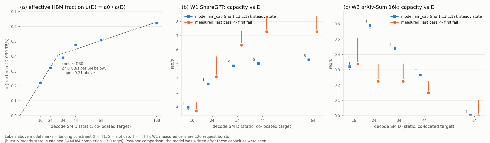

# 제안 — static decode SM D\*를 하드웨어·모델 항과 측정 비용 항으로 도출하는 식 (2026-10-30)

> **지위: 제안(결정 61).** 정본이 아니다. analytic-v1(`ANALYTIC_COST_FORMULAS.md`)은 바꾸지 않고 사전(prior)으로 불러 쓴다. 정본 수식 §8 표의 "PD-mux SM 분할" 칸을 채우는 확장 후보다.
> **새 측정 0, GPU 0.** 입력은 이미 회수된 비용 항(T1·T2·T2′·T3)과 정책 캠페인 trace다.
> **오염 공시:** 식은 CAP1·CAP1-R·CAP2·TUNE 결과를 본 **뒤에** 썼다. 그래서 §4의 대조는 **사후 재현(retrodiction)**이지 예측이 아니다. 예측으로 셀 수 있는 것은 §5의 EVAL 사전 예측뿐이다. EVAL은 이 문서를 커밋하는 시점에 제출되지 않았다.
> 코드 `workspace/engine-port/scripts/costmodel/dstar_model.py` · 시험 `workspace/engine-port/tests/test_dstar_model.py`(7개) · 산출 `reports/cost_model/dstar/`(`workload_summary.json` sha256 `96b79b35…`, `dstar_result.json` `b6b94826…`, 그림 `dstar_capacity.png`).
> 라벨: [유도] analytic-v1 닫힌 식 · [측정] 비용 항 계수 전사 · [모델] 아래 서빙 모형의 출력 · [가정] A1–A9.

## 1. 식

### 1-1. 세 층

| 층 | 무엇 | 출처 |
|---|---|---|
| 하드웨어·모델 [유도] | a₀ = 가중치 바이트 / HBM BW = **8.14 ms**(Nano, 2.039 TB/s), prefill FLOPs | `analytic_terms.py` |
| 비용 항 [측정] | T_dec(D, b, c): T1, sticky D 5개 + 108u, 채택 형 F1/F2/F3, 두 round 평균 · T2(L; 108) · T2′(32k; P) · ρ 1.13–1.19 | `RESULT_costterms_2026-10-26.md` §2–§5, `supplement_costterms_2026-10-27.json` |
| 서빙 [모델] | 비sticky lockstep PD-mux. 동거 중에만 D, 그 밖엔 108 SM(결정 49) | 이 문서 §1-2 |

### 1-2. 서빙 모형 (P = 108 − D)

```
S_pre(L)  = κ · T2(L; 108) · 108 / P                 요청 하나의 prefill 시간
f         = min(1, λ · E[S_pre])                     동거 비율(prefill이 도는 시간 비율)
T_co(b)   = ρ · T_dec(D, b, c)                       동거 중 decode step
T_solo(b) = T_dec(108u, b, c)                        decode만 있을 때
T_eff     = f · T_co + (1 − f) · T_solo
b         = λ · E[R] · T_eff                         decode 점유(Little 법칙, 고정점)
```

λ에서 가능하려면 세 제약을 모두 만족해야 한다.

- **ITL**: 요청 내부 p95를 정하는 step(f > 5%면 T_co, 아니면 T_solo)을 b95 = b + 1.645√b(≤ cap)에서 계산해 ≤ S_ITL
- **SLOT**: λ · (E[R] · T_eff + E[S_pre] + W) ≤ cap (max_running_requests 48)
- **TTFT**: S_pre(L_q90) + W ≤ S_TTFT, W = M/G/1 평균 대기

λ_cap(D)는 그 값 이하의 모든 λ가 가능한 최대 λ이고, D\* = argmax_D λ_cap(D)다.

### 1-3. 두 개의 벽 (대기열 이전의 닫힌 형태)

- **아래 벽 (decode가 ITL을 지키는 최소 D)**: ρ · T_dec(D, b_peak, c) ≤ S_ITL. decode-heavy 부하에서 b_peak는 cap까지 간다.
- **위 벽 (prefill이 TTFT를 지키는 최대 D)**: D ≤ 108 − κ · T2(L_q90) · 108 / S_TTFT.

이 창 안에서 대기열 항이 D\*를 고른다.

| | L_q90 | 아래 벽 (cap 48, ρ 1.16) | 위 벽 | 동거 step @cap 48 (ρ 1.16): D16 / 24 / 34 / 44 / 64 |
|---|---|---|---|---|
| W1 ShareGPT | 686 | **D34** | 104.8 | 106.9 / 75.4 / **56.1** / 47.5 / 36.3 ms |
| W3 arXiv-Sum 16k | 12,471 | (W3는 capacity에서 b ≈ 17이라 cap 벽이 걸리지 않음) | **54.4** | 115.0 / 81.4 / 60.8 / 52.1 / 40.9 ms |

**D44의 정체 [모델]**: W1에서는 아래 벽이 D24와 D34 사이에서 닫힌다. 그 위(D34–D64)에서는 용량이 slot cap과 108 SM decode step으로 정해지는 고원이다(λ_cap 4.86 → 5.03 → 5.30, D34 대비 +3.5% / +9%). D44는 이 고원 안의 한 점이다. 최적 "점"이라기보다 "벽 위 고원"으로 설명된다.

## 2. 하드웨어 층: u(D) = a₀ / a(D) [유도 a₀ + 측정 a(D)]

| D | 16 | 24 | 34 | 44 | 64 | 108 |
|---|---|---|---|---|---|---|
| a(D) ms | 36.79 | 25.32 | 20.85 | 17.10 | 16.03 | 13.06 |
| u | 0.221 | 0.321 | 0.390 | 0.476 | 0.508 | 0.623 |
| u / SM | 0.0138 | 0.0134 | 0.0115 | 0.0108 | 0.0079 | 0.0058 |

- 원점을 지나는 2구간 적합: 무릎 **D ≈ 30**, 무릎 아래 SM당 **27.6 GB/s**(β = 0.0135/SM), 무릎 위 기울기는 아래의 **0.21배** [모델 적합, 6점].
- 해석 [가정 A2]: a(D)에는 대역폭이 아닌 step 고정비(launch·sampling)도 섞여 있어서, u는 순수 HBM 비율이 아닌 실효 비율이다. "decode는 SM 약 30개까지 대역폭에 거의 선형으로 붙고, 그 뒤로는 SM당 이득이 1/5로 준다"까지만 말한다. D44를 이 무릎으로 설명하지 **않는다**. W1의 D\*는 무릎(D30)이 아니라 ITL 벽(D34)과 cap 고원이 정했다.
- κ(D) = T2′(32k; P)·P / (T2(32k; 108)·108) = **1.011–1.021**: prefill은 P에 거의 정확히 반비례한다(동거 효과 포함). 즉 prefill은 SM 수에 선형이고 decode는 무릎 뒤 포화한다. 이 비대칭이 분할 최적이 존재하는 물리적 이유다.

## 3. 입력 워크로드 (`workload_summary.json`)

| | 입력 평균 | 출력 평균 | decode ctx 평균 | 출처 |
|---|---|---|---|---|
| W1 | 230 | 286(ignore_eos 고정) | 373 | ShareGPT 풀 56,132쌍(CAP2 raw `w1_lengths.json`), seeded 표본 4,000 |
| W3 | 7,105(p50 6,469, p90 12,471) | 1,007(98.2%가 cap 1024) | 7,609 | CAP2 segments 2,880 요청. 출력 길이는 결과에서 읽음(워크로드 속성, arm 무관 설계 — 공시) |

## 4. 사후 재현 — CAP1·CAP1-R(W1), CAP2(W3) 대비 (예측 아님)



볼 것: (a) u(D)의 무릎, (b)·(c) 파란 사각(모델 λ_cap, ρ 띠)과 주황 구간(측정 통과 → 첫 실패)의 **순서와 구속 제약 글자**.

| W | D | 모델 λ_cap (ρ 1.13–1.19) | 모델 구속 | 측정 용량 구간 | 측정 첫 실패의 주 실패 사유 (요청 비율) |
|---|---|---|---|---|---|
| W1 | 16 | 1.92 (1.78–2.06) | ITL | [1.66, 2.24) CAP1 | ITL 0.82 |
| W1 | 24 | 3.58 (3.47–3.68) | ITL | [4.09, 5.52) CAP1 | ITL 0.65 |
| W1 | 34 | 4.86 (4.82–4.91) | SLOT | [6.34, 7.29) | TTFT 0.10, ITL 0 |
| W1 | 44 | 5.03 (4.98–5.08) | SLOT | [7.29, 8.39) | TTFT 0.30, ITL 0 |
| W1 | 64 | 5.30 (5.23–5.37) | SLOT | [7.29, 8.39) | TTFT 0.29, ITL 0 |
| W3 | 16 | 0.32 (0.30–0.35) | ITL | [0.3375, 0.506) | ITL 0.41 (TTFT 0.08) |
| W3 | 24 | 0.59 (0.57–0.59) | ITL·TTFT | [0.225, 0.3375) | TTFT 0.12, ITL 0 |
| W3 | 34 | 0.44 | TTFT | [0.225, 0.3375) | TTFT 0.20 |
| W3 | 44 | 0.265 | TTFT | [0.15, 0.225) | TTFT 0.10 |
| W3 | 64 | 0 | TTFT | < 0.1 | TTFT 0.20 (λ 0.1에서도) |

(실패 사유는 raw segments 요청별 TTFT > SLO, 요청 내부 ITL p95 > 60 ms로 재집계했다. 기술값이다.)

- **맞은 것**
  - **구속 제약의 종류**: W1 5/5(SLOT은 실측에서 대기열 성장 → TTFT 실패로 나타남), W3 4/5(D24는 모델이 ITL·TTFT 둘 다, 실측은 TTFT만).
  - **W1 순서**: D16 < D24 < D34 < D44 ≤ D64.
  - **D\*가 워크로드에 따라 반대로 움직임**: W1은 큰 D, W3는 작은 D.
  - **W3 D64 불가능**: 위 벽 54.4 < 64.
- **틀린 것**
  - **W3 상위 순서**: 모델은 D24 > D34 > D16, 실측은 D16 > D24 = D34. TTFT 구속 셀(D24–D44)에서 모델 용량이 1.2–2.6배 낙관적이다. 원인 후보는 A7(q90 서비스 + **평균** 대기, 꼬리 과소)과 A4(배치 prefill에서 앞 요청이 배치 전체를 기다림)다.
- **크기 비교 불가 (W1)**: 측정 구간은 120요청 **버스트** 셀이고 모델은 정상상태다. 지속 600 s에서 D44·D64 완료율은 약 3.0 req/s였다(CAP2 지속성 블록). 모델 값 5.0–5.3은 지속 과부하 완료율과 버스트 통과 rate 사이에 있다. W1의 절대값 일치는 주장하지 않는다.

## 5. EVAL 사전 예측 (봉인 = 이 문서의 커밋 해시, EVAL 결과 전)

대상: PREREG_HD_HE0cell rev1.7 §22 EVAL의 static arm 5개(W1 HE0 셀, LO 2.7356 / HI 10.9424 req/s, 구간당 200, 3 라운드, SLO 3000 ms / 60 ms, n = 4 seed = EVAL-a·b). 채점 데이터 = EVAL 결과의 seed 평균 TRUE goodput(duration 합산)과 구간별 값. 항목별로 HIT/MISS만 적고 종합 판정은 하지 않는다. 결과는 result-analyst와 claims-auditor에게 넘긴다.

모델 출력 (ρ 1.16, 괄호는 ρ 1.13–1.19, `dstar_result.json` `eval_prediction`):

| D | LO 좋은 요청 비율 | HI goodput / D44 | 전체 goodput / D44 |
|---|---|---|---|
| 16 | 0.023 | 0 (HI ITL 불가) | 0.016 |
| 24 | 1.00 | 0 (HI ITL 불가: 동거 step 75 ms at cap) | 0.730 (0.729–0.730) |
| 34 | 1.00 | 0.958 (0.957–0.959) | 0.986 |
| 44 | 1.00 | 1 | 1 |
| 64 | 1.00 | 1.070 (1.066–1.074) | 1.022 (1.021–1.023) |

등록 예측 (허용 띠는 모델 값에 모형 오차를 얹은 것이다; 데이터 전에 고정한다):

| ID | 예측 | 모델 값 |
|---|---|---|
| E-1 | 전체 goodput 순서: G16 < G24 < min(G34, G44, G64) | 성립 |
| E-2 | 상위 고원: max/min{G34, G44, G64} ≤ 1.06 | 1.037 |
| E-3 | G64 / G44 ∈ [0.98, 1.08] | 1.022 |
| E-4 | G34 / G44 ∈ [0.93, 1.01] | 0.986 |
| E-5 | G24 / G44 ∈ [0.55, 0.85] | 0.730 |
| E-6 | G16 / G44 ≤ 0.30 | 0.016 |
| E-7 | LO 구간 좋은 요청 비율: D16 ≤ 0.5, D24·D34·D44·D64 ≥ 0.9 | 0.023 / 1.0 |
| E-8 | HI goodput: D16·D24 ≤ 0.25 × D44, D34/D44 ∈ [0.88, 1.01], D64/D44 ∈ [1.00, 1.15] | 0 / 0.958 / 1.070 |

- **채점하지 않는 것 (오염)**: D44의 절대 goodput. TUNE에서 D44에 고정된 동적 arm이 LO 2.42, HI 1.72–1.74 req/s를 보였고 이를 본 뒤 썼다. 모델은 LO 2.74, HI 1.59다(LO 차이는 모델 duration이 drain을 빼서다 — A9).
- **가장 강한 예측은 E-8의 "static D24 HI ≈ 0"이다.** TUNE에서 D24 앵커 동적 구성은 HI 1.32–1.41을 냈다. 그 구성은 컨트롤러가 D를 올릴 수 있었으므로 static D24와 같지 않다. 이 차이 자체가 EVAL에서 드러난다.

## 6. 가정과 한계 (A1–A9)

- A1: sticky-D 무경합 T1 계수가 비sticky 동거 decode에 ρ를 곱해 옮겨진다.
- A2: a(D)는 실효값이다(대역폭 아닌 고정비 포함).
- A3: S_pre는 T2(L; 108)를 108/P와 κ로 축척한다. W1의 L < 1k는 T2 격자(1k–64k) 밖 외삽이다.
- A4: 요청별 prefill에 배치 상각이 없다(W1에는 보수, W3에는 앞 요청의 배치 대기를 놓쳐 낙관).
- A5: f = λE[S](decode가 비지 않는다고 둠).
- A6: ITL p95 규칙은 f > 5%에서 동거 step(b95)이 정하는 경성 문턱이다(실제는 연속적).
- A7: TTFT = q90 서비스 + M/G/1 **평균** 대기 → 꼬리 과소. §4의 W3 miss 원인 후보.
- A8: ρ는 D·b 무관 상수 띠다. CM-4는 ρ의 D 순서 서술을 금지하므로 띠로만 쓴다.
- A9: EVAL HI는 slot 포화 + 완료율 μ, 좋은 요청 = cap + μ·S_TTFT(ITL 통과 시), duration은 drain을 뺐다.
- 기판·범위: VESSL A100·Nano-9B-v2·flashinfer·cudagraph ON·cap 48·mem 0.6·budget 65536·비sticky 공개 루프 한정이다. KISTI·Zamba2 결과(HE0의 D44)는 analytic-v1 밖이라 이 식으로 재현하지 않는다(결정 46).
- 구현 결함(B1–B6, `impl_defects`)은 모델에 없다. static arm에는 B2·B3가 걸리지만, 모델의 SLOT·TTFT 항은 B3(단일 prefill 배치)를 대기열로만 근사한다.

## 7. 다음

1. EVAL 회수 → E-1…E-8 채점(result-analyst) → 사후 해석 감사 1회(claims-auditor).
2. W3 TTFT 항: A7을 대기 꼬리 근사(M/G/1 대기 분포 꼬리)로 바꾸는 r1은 **EVAL 채점 뒤에만** 한다. 지금 바꾸면 본 데이터에 맞춘 것이 된다. 바꾸면 H-D(W3) 재개 시 사전 예측으로 다시 건다.
3. 정본 반영은 결과가 나온 뒤 promote가 판단한다. 수식 문서 §8 "PD-mux SM 분할" 칸, CM-1·CM-6 연결.

## cost model 기여
- CM-1: sticky-D T1 계수를 analytic a₀로 나누면 실효 대역폭 비율 u(D)가 나온다. 무릎 D ≈ 30, SM당 27.6 GB/s, 무릎 위 기울기 0.21배 [모델 적합, 6점, 인용 전 감사 필요].
- CM-2: T2′·P / (T2·108) = κ 1.011–1.021. prefill은 동거 상태에서도 P에 반비례한다 [유도, 32k 한 점].
- CM-6 연결: 두 벽(ITL 아래 벽, TTFT 위 벽)과 slot 고원으로 W1·W3의 best D 방향(44/64 대 16)과 구속 제약 종류를 사후 재현했다. 크기와 W3 상위 순서는 맞추지 못했다. 예측력 판정은 §5 EVAL 채점에 달려 있다.
