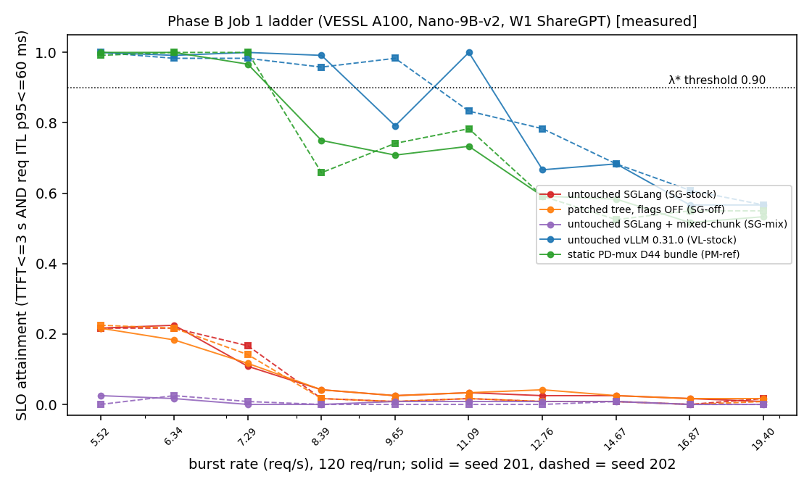
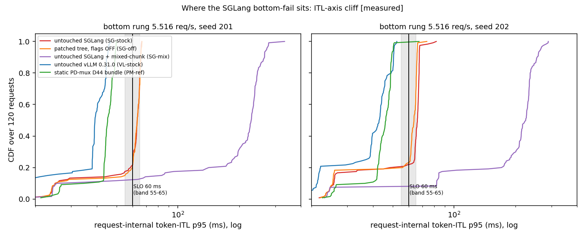
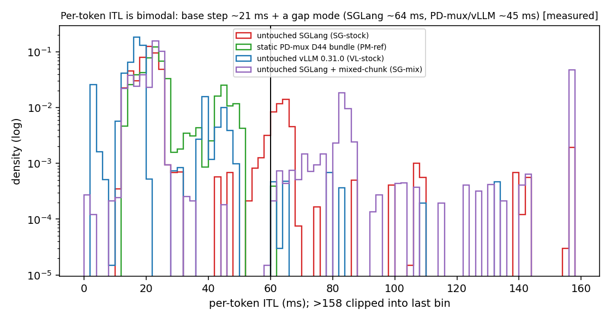

# Phase B 첫 번째 Job(용량 사다리) 결과 — 기본 서빙 구조 기준선, VESSL·Nano (2026-11-03, result-analyst)

> 지위: **결과 분석(봉인 규칙 적용만, 새 판정 없음)**. 사전등록 = `PREREG_STOCK_BASE_rev1_DRAFT_2026-11-02.md`(rev2.1, sha `b2126bd9…`) · 사전 예측 = `PREDICTION_phaseB_expected_effects_2026-11-02.md`(sha `5923a533…`) · 하네스 감사 r1·r2. 두 문서와 분석기(`sb_analyze.py`, sha `ed7bfa4a…`)는 `HARNESS_DIGEST.txt`의 봉인 sha와 일치함을 확인했다. 감사 전이며 정본 반영은 promote 몫이다.
> 라벨: [측정] raw에서 직접 · [유도] raw에서 계산(봉인 규칙 밖 계산 포함, 표시함) · [가정] 검증 안 된 해석.
> arm 이름: 손대지 않은 SGLang(`SG-stock`) · 수정 트리·플래그 OFF SGLang(`SG-off`) · 손대지 않은 SGLang + mixed-chunk(`SG-mix`) · 손대지 않은 vLLM 0.31.0(`VL-stock`) · static PD-mux D44 구성 묶음(`PM-ref`).

## 0. 한 줄 판정

**봉인 규칙 출력 그대로: 손대지 않은 SGLang 계열 3 arm은 등록 격자 최저 rung(5.516 req/s)에서 이미 attainment 0.90에 못 미쳐(`LADDER_BOTTOM_FAIL`) 버스트 용량 값이 없다. vLLM 8.389146 · PD-mux 구성 묶음 7.29491 req/s(`BRACKETED`). 그 결과 등록 규칙상 두 번째 Job의 계획 자체가 만들어지지 않는다(`ABORT_NO_ADDENDUM`).** 손대지 않은 SGLang과 수정 트리 OFF SGLang의 실패는 **TTFT가 아니라 요청 내부 ITL p95 항**에서 나오고, 그 값이 60 ms 경계 바로 위(요청 중앙 63–66 ms)에 몰려 있다 — **ITL 축의 metric cliff**다(SLO를 +10% 옮기면 attainment 0.22 → 0.93–0.95, 진단용 계산이며 결론 아님). 호출자 가설 "기본 decode step 자체가 ~60 ms"는 raw와 **맞지 않는다**: 요청 내부 ITL **p50은 21 ms**이고, 60 ms대 값은 별도의 "간극(gap) 모드"(토큰의 약 10%)에서 나온다. mixed-chunk arm은 절벽이 아니라 확실한 실패다(간극 160–240 ms, TTFT 실패도 절반 가까이).

- 정책 결론: **없음**(이 Job은 판정 셀이 아니다. 사다리 rung당 seed 2개, 등록된 쌍 라벨 없음 → arm 간 차이는 underpowered·기술값만).
- 다음에 필요한 것: 사용자 결정(§8 선택지) — 등록 규칙으로는 다음 Job을 낼 수 없다.

## 1. 대상·재현·스탬프 [측정]

| 항목 | 값 |
|---|---|
| Job | `pdmux-stock-baseline-7899d1b-20261102085423`(커밋 `7899d1b0`), 시작 09:19:23Z → 끝 10:35:12Z(75.8 min; 시간 모형 추정 206.0 min·하드캡 260), exit 0, DONE 2026-11-02T10:35:21Z |
| GPU | NVIDIA A100-SXM4-80GB, UUID `GPU-bc0be109-1009-6020-342b-305df4a1541f`, 드라이버 580.178.04, cc 8.0, 전력 한도 400 W, MIG off, 호스트 `job-4ma8ia5u8cfx-n9qbd`, 1장 |
| 이미지 | `ghcr.io/asuan99/sglang-vllm-runtime@sha256:a5f9bf0f…`; SGLang freeze `45c39de2…`, vLLM venv freeze `adff2ff0…`(vLLM boot 스탬프 실패 0) |
| 엔진 트리 | 봉인 digest `2836112b…` = 실측(match=True) · pristine 보존 `PRESERVE_STATUS` OK(manifest `1bd84d88…` = 참조, 2258항목) · 손대지 않은 SGLang·mixed-chunk boot = pristine, 마커 0 · 수정 트리 OFF·PD-mux boot = patched manifest `525c6bce…`, 마커 6 — `tree_failures` 0건, `patched_manifest_failures` 0, `stamp_failures` 0(전 run 같은 Job·같은 GPU) |
| plan | sha `1482de03…` = `HARNESS_DIGEST.txt` plans_sha J1 |
| raw | `raw/SHA256SUMS` 295/295 OK(로컬 재검사) |
| trace | 20개 (rate, seed) 셀마다 5 arm의 trace hash가 1개로 동일 |
| 서버 설정(로그 채취) | 손대지 않은 SGLang·수정 트리 OFF: chunked prefill 8192, overlap ON, mixed OFF, flashinfer, cudagraph ON(bs 1–48 캡처), mem 0.836 · mixed-chunk: 위 + `enable_mixed_chunk=True`(chunked 8192 > 0 → 등록 발화 조건 충족) · PD-mux 묶음: chunked −1, overlap OFF, mem 0.6, mamba cache 48 · vLLM: FLASH_ATTN, CUDAGraphMode FULL_AND_PIECEWISE |
| boot 순서(각 arm 1 boot, rung·seed 순서는 boot 안에서 무작위) | smoke 2 → PD-mux 묶음(09:31–09:42) → 수정 트리 OFF(09:44–09:54) → mixed-chunk(09:56–10:11) → 손대지 않은 SGLang(10:13–10:24) → vLLM(10:26–10:35) |
| 정확성 검사 | 5 boot 전부 `n_bad` 0 |
| 각 run 구조 | segment 1개(라운드 append 없음 → duration 합산(max 금지) 문제 해당 없음, 분모 = 그 segment duration) |

**CPU 재현**: `sb_analyze.py addendum --j1 <raw>` 재실행 결과가 기존 `ADDENDUM_J1.json`(sha `efe57f27…`)과 **키 전부 동일**. `sb_analyze.py report --j1 <raw>`도 오류 없이 돈다(J1b·J2·J3 raw 없음 → 해당 항목은 자동으로 NOT_MEASURED). 보고서 JSON은 결과 디렉터리에 쓰지 않았다(아래 수치는 그 출력 + 같은 봉인 함수 `attainment`/`goodput`/`V.req_good`/`V.percentile`로 만든 표).

## 2. 용량 사다리 — arm × rung × seed attainment [측정]

attainment = 요청 중 (오류 없음 ∧ TTFT ≤ 3000 ms ∧ 요청 내부 token-ITL p95 ≤ 60 ms) 비율, 120요청/run. 칸 = seed 201 / seed 202.

| rung (req/s) | SG-stock | SG-off | SG-mix | VL-stock | PM-ref |
|---|---|---|---|---|---|
| 5.516 | 0.217 / 0.217 | 0.217 / 0.225 | 0.025 / 0.000 | 1.000 / 1.000 | 1.000 / 0.992 |
| 6.3434 | 0.225 / 0.217 | 0.183 / 0.217 | 0.017 / 0.025 | 0.992 / 0.983 | 1.000 / 1.000 |
| 7.29491 | 0.108 / 0.167 | 0.117 / 0.142 | 0.000 / 0.008 | 1.000 / 0.983 | 0.967 / 1.000 |
| 8.38915 | 0.042 / 0.017 | 0.042 / 0.017 | 0.000 / 0.000 | 0.992 / 0.958 | 0.750 / 0.658 |
| 9.64752 | 0.025 / 0.008 | 0.025 / 0.008 | 0.008 / 0.000 | 0.792 / 0.983 | 0.708 / 0.742 |
| 11.0946 | 0.033 / 0.017 | 0.033 / 0.017 | 0.008 / 0.000 | 1.000 / 0.833 | 0.733 / 0.783 |
| 12.7588 | 0.025 / 0.008 | 0.042 / 0.008 | 0.008 / 0.000 | 0.667 / 0.783 | 0.592 / 0.592 |
| 14.6727 | 0.025 / 0.008 | 0.025 / 0.008 | 0.008 / 0.008 | 0.683 / 0.683 | 0.583 / 0.525 |
| 16.8736 | 0.017 / 0.000 | 0.017 / 0.000 | 0.000 / 0.000 | 0.567 / 0.608 | 0.517 / 0.550 |
| 19.4046 | 0.008 / 0.017 | 0.017 / 0.008 | 0.000 / 0.000 | 0.567 / 0.567 | 0.533 / 0.550 |

봉인 `lambda_pick` 출력(동률 → 낮은 rate): 손대지 않은 SGLang `LADDER_BOTTOM_FAIL` · 수정 트리 OFF `LADDER_BOTTOM_FAIL` · mixed-chunk `LADDER_BOTTOM_FAIL` · vLLM **8.389146 `BRACKETED`**(9.647518 s201 0.792에서 끊김) · PD-mux 묶음 **7.29491 `BRACKETED`**(8.389146에서 0.750/0.658). `refcell_rate` = 손대지 않은 SGLang 버스트 λ\* = **None**.
- 분산 [유도]: 최저 rung attainment 평균 ± SD(n=2 seed) — 손대지 않은 SGLang 0.217 ± 0.000 · 수정 트리 OFF 0.221 ± 0.006 · mixed-chunk 0.013 ± 0.018 · vLLM 1.000 ± 0.000 · PD-mux 묶음 0.996 ± 0.006. n=2라 seed 간 분산 추정 자체가 underpowered다(게이트 1).
- vLLM 사다리는 단조가 아니다(9.647518 s201 0.792 → 11.094646 s201 1.000). 120요청 버스트 run의 seed 잡음이 rung 간 차보다 클 수 있어 λ\*는 "격자 위 첫 끊김"이라는 규칙 값이지 정밀 용량이 아니다.
- 이 PD-mux 묶음 값 7.29491이 이전 VESSL 캠페인(CAP1-R)의 같은 rung과 같은 것은 **격자를 승계했기 때문**이며 기판 동일성의 증거가 아니다(인용 금지 문장 2 승계).

`figures/j1_ladder_attainment.png` — 볼 것: SGLang 3 arm(빨강·주황·보라)이 최저 rung부터 0.25 아래에 붙어 있고, vLLM·PD-mux 묶음만 0.90 선을 넘는 구간이 있다.

## 3. arm·rung별 지연·실패 분해 [측정]

칸 = seed 201 / seed 202. TTFT ms(run 단위 p50/p95/p99), "요청 ITL p50/p95 중앙" = 요청마다 token-ITL의 p50/p95를 구한 뒤 120요청의 중앙값(ms). 실패 수는 요청 수(120 중): TTFT 실패 = TTFT > 3000 ms, ITL 실패 = 요청 내부 ITL p95 > 60 ms, 둘 다 = 교집합. 오류 = 요청 오류 수. duration = 그 run segment의 부하 창(s).
★게이트 4 차단형: "TTFT ≤ SLO 비율" 열이 0.5 미만인 run(mixed-chunk의 7.29491 s201과 8.389146 이상 전 run)은 과부하 구간이다. 이 문서는 어느 구간에서도 **arm 간 차이의 % 크기를 쓰지 않는다**(사다리는 판정 셀이 아니다). 과부하 rung의 attainment 값은 120요청 run 길이에 의존한다(ill-posed) — 그 rung의 수치는 λ\* 규칙 입력 외로 인용하지 않는다.

| arm | rung | 오류 | duration s | TTFT p50 | TTFT p95 | TTFT p99 | 요청 ITL p50 중앙 | 요청 ITL p95 중앙 | TTFT 실패 | ITL 실패 | 둘 다 | TTFT≤SLO 비율 |
|---|---|---|---|---|---|---|---|---|---|---|---|---|
| SG-stock | 5.516 | 0/0 | 33.9 / 34.6 | 90 / 114 | 741 / 2496 | 945 / 2658 | 21.3 / 21.3 | 63.2 / 66.1 | 0 / 0 | 94 / 94 | 0 / 0 | 1.00 / 1.00 |
| SG-stock | 6.3434 | 0/0 | 34.6 / 31.3 | 178 / 96 | 961 / 1671 | 1282 / 1912 | 23.2 / 22.9 | 73.9 / 64.4 | 0 / 0 | 93 / 94 | 0 / 0 | 1.00 / 1.00 |
| SG-stock | 7.29491 | 0/0 | 31.8 / 31.6 | 261 / 322 | 3446 / 2879 | 3757 / 3098 | 24.0 / 23.5 | 66.7 / 65.6 | 21 / 4 | 91 / 96 | 5 / 0 | 0.82 / 0.97 |
| SG-stock | 8.38915 | 0/0 | 33.7 / 31.0 | 378 / 1601 | 5193 / 6361 | 5589 / 6790 | 24.0 / 24.2 | 66.7 / 65.8 | 36 / 45 | 98 / 105 | 19 / 32 | 0.70 / 0.62 |
| SG-stock | 9.64752 | 0/0 | 32.6 / 28.6 | 764 / 639 | 8711 / 5594 | 9211 / 5868 | 24.0 / 24.1 | 67.1 / 73.0 | 47 / 35 | 99 / 101 | 29 / 17 | 0.61 / 0.71 |
| SG-stock | 11.0946 | 0/0 | 28.3 / 29.4 | 137 / 419 | 4599 / 7813 | 5123 / 7988 | 23.9 / 24.1 | 65.4 / 66.5 | 32 / 39 | 101 / 101 | 17 / 22 | 0.73 / 0.68 |
| SG-stock | 12.7588 | 0/0 | 31.1 / 31.0 | 1200 / 1808 | 9021 / 8887 | 9491 / 9303 | 24.1 / 24.1 | 67.4 / 65.9 | 50 / 51 | 102 / 102 | 35 / 34 | 0.58 / 0.57 |
| SG-stock | 14.6727 | 0/0 | 31.0 / 29.5 | 2015 / 2591 | 9964 / 9639 | 10496 / 9881 | 24.1 / 24.1 | 66.3 / 65.9 | 54 / 59 | 102 / 102 | 39 / 42 | 0.55 / 0.51 |
| SG-stock | 16.8736 | 0/0 | 30.1 / 30.7 | 1888 / 1458 | 12285 / 10811 | 13004 / 11526 | 24.1 / 24.1 | 66.6 / 65.6 | 58 / 54 | 96 / 105 | 36 / 39 | 0.52 / 0.55 |
| SG-stock | 19.4046 | 0/0 | 30.6 / 30.5 | 3014 / 2096 | 11648 / 12287 | 12216 / 12874 | 24.2 / 24.1 | 66.6 / 65.6 | 60 / 55 | 95 / 98 | 36 / 35 | 0.50 / 0.54 |
| SG-off | 5.516 | 0/0 | 34.0 / 34.4 | 85 / 110 | 748 / 2434 | 901 / 2605 | 21.4 / 21.3 | 63.2 / 63.6 | 0 / 0 | 94 / 93 | 0 / 0 | 1.00 / 1.00 |
| SG-off | 6.3434 | 0/0 | 34.3 / 31.5 | 132 / 111 | 738 / 1750 | 1054 / 2033 | 23.2 / 23.0 | 66.3 / 65.6 | 0 / 0 | 98 / 94 | 0 / 0 | 1.00 / 1.00 |
| SG-off | 7.29491 | 0/0 | 31.8 / 31.7 | 257 / 293 | 3408 / 2932 | 3729 / 3180 | 24.1 / 23.4 | 66.3 / 66.2 | 21 / 4 | 89 / 99 | 4 / 0 | 0.82 / 0.97 |
| SG-off | 8.38915 | 0/0 | 33.8 / 31.0 | 365 / 1656 | 5289 / 6327 | 5635 / 6762 | 24.1 / 24.2 | 65.9 / 66.2 | 38 / 47 | 102 / 105 | 25 / 34 | 0.68 / 0.61 |
| SG-off | 9.64752 | 0/0 | 32.6 / 28.1 | 712 / 481 | 8579 / 5191 | 9133 / 5375 | 24.0 / 24.1 | 65.9 / 65.7 | 47 / 33 | 96 / 99 | 26 / 13 | 0.61 / 0.72 |
| SG-off | 11.0946 | 0/0 | 28.5 / 29.4 | 159 / 413 | 4720 / 7805 | 5252 / 8009 | 23.9 / 24.1 | 65.4 / 66.8 | 32 / 37 | 101 / 101 | 17 / 20 | 0.73 / 0.69 |
| SG-off | 12.7588 | 0/0 | 31.0 / 31.2 | 1178 / 1837 | 8985 / 9052 | 9446 / 9438 | 24.1 / 24.1 | 66.7 / 66.8 | 49 / 51 | 101 / 102 | 35 / 34 | 0.59 / 0.57 |
| SG-off | 14.6727 | 0/0 | 31.0 / 29.4 | 1982 / 2584 | 10017 / 9618 | 10507 / 9857 | 24.1 / 24.1 | 66.1 / 65.9 | 53 / 59 | 102 / 102 | 38 / 42 | 0.56 / 0.51 |
| SG-off | 16.8736 | 0/0 | 30.2 / 30.6 | 1882 / 1451 | 12318 / 10686 | 13133 / 11405 | 24.1 / 24.1 | 66.7 / 65.5 | 58 / 54 | 97 / 104 | 37 / 38 | 0.52 / 0.55 |
| SG-off | 19.4046 | 0/0 | 30.6 / 30.5 | 2944 / 2084 | 11618 / 12246 | 12189 / 12827 | 24.1 / 24.1 | 65.8 / 65.3 | 60 / 55 | 98 / 99 | 40 / 35 | 0.50 / 0.54 |
| SG-mix | 5.516 | 0/0 | 47.4 / 49.0 | 2024 / 787 | 12273 / 15562 | 12771 / 16643 | 24.0 / 24.0 | 228.8 / 224.3 | 50 / 51 | 106 / 111 | 39 / 42 | 0.58 / 0.57 |
| SG-mix | 6.3434 | 0/0 | 48.2 / 45.1 | 2573 / 897 | 13062 / 14396 | 14760 / 15490 | 23.9 / 24.1 | 240.5 / 239.5 | 58 / 50 | 105 / 103 | 45 / 36 | 0.52 / 0.58 |
| SG-mix | 7.29491 | 0/0 | 46.6 / 47.4 | 3291 / 3082 | 16630 / 16559 | 17928 / 18400 | 24.1 / 24.2 | 234.5 / 248.5 | 61 / 60 | 108 / 110 | 49 / 51 | 0.49 / 0.50 |
| SG-mix | 8.38915 | 0/0 | 48.0 / 45.3 | 4324 / 4737 | 19321 / 20135 | 19521 / 21047 | 24.1 / 24.2 | 233.2 / 256.3 | 62 / 66 | 112 / 107 | 54 / 53 | 0.48 / 0.45 |
| SG-mix | 9.64752 | 0/0 | 46.4 / 43.9 | 4077 / 4232 | 21576 / 19633 | 23105 / 21285 | 24.0 / 24.1 | 237.3 / 246.5 | 63 / 64 | 106 / 111 | 50 / 55 | 0.47 / 0.47 |
| SG-mix | 11.0946 | 0/0 | 42.7 / 44.1 | 4204 / 3892 | 17707 / 21729 | 19458 / 22668 | 24.0 / 24.1 | 232.3 / 246.1 | 63 / 64 | 108 / 107 | 52 / 51 | 0.47 / 0.47 |
| SG-mix | 12.7588 | 0/0 | 45.9 / 45.7 | 4297 / 5295 | 23182 / 22331 | 24109 / 23740 | 24.1 / 24.1 | 248.1 / 218.2 | 63 / 67 | 107 / 110 | 51 / 57 | 0.47 / 0.44 |
| SG-mix | 14.6727 | 0/0 | 46.2 / 44.7 | 5673 / 6206 | 23748 / 23746 | 25654 / 24924 | 24.1 / 24.0 | 230.2 / 238.7 | 68 / 67 | 109 / 106 | 58 / 54 | 0.43 / 0.44 |
| SG-mix | 16.8736 | 0/0 | 46.2 / 45.6 | 5675 / 5191 | 27298 / 24054 | 28781 / 26193 | 24.0 / 24.1 | 231.7 / 215.6 | 65 / 67 | 111 / 110 | 56 / 57 | 0.46 / 0.44 |
| SG-mix | 19.4046 | 0/0 | 46.1 / 44.1 | 5919 / 5117 | 25959 / 24933 | 27461 / 26282 | 24.1 / 24.0 | 242.4 / 210.5 | 65 / 66 | 110 / 104 | 55 / 50 | 0.46 / 0.45 |
| VL-stock | 5.516 | 0/0 | 31.4 / 30.9 | 61 / 77 | 134 / 163 | 177 / 211 | 17.5 / 17.9 | 39.2 / 43.0 | 0 / 0 | 0 / 0 | 0 / 0 | 1.00 / 1.00 |
| VL-stock | 6.3434 | 0/0 | 31.5 / 28.4 | 71 / 65 | 269 / 152 | 399 / 215 | 18.0 / 18.2 | 44.8 / 39.9 | 0 / 0 | 1 / 2 | 0 / 0 | 1.00 / 1.00 |
| VL-stock | 7.29491 | 0/0 | 27.2 / 27.7 | 83 / 74 | 237 / 212 | 507 / 322 | 20.5 / 18.6 | 44.7 / 44.7 | 0 / 0 | 0 / 2 | 0 / 0 | 1.00 / 1.00 |
| VL-stock | 8.38915 | 0/0 | 28.4 / 25.9 | 193 / 188 | 1167 / 2310 | 1395 / 2606 | 21.4 / 21.5 | 45.1 / 46.3 | 0 / 0 | 1 / 5 | 0 / 0 | 1.00 / 1.00 |
| VL-stock | 9.64752 | 0/0 | 27.4 / 23.6 | 176 / 110 | 4764 / 1878 | 4871 / 2023 | 21.3 / 20.8 | 45.4 / 44.4 | 23 / 0 | 2 / 2 | 0 / 0 | 0.81 / 1.00 |
| VL-stock | 11.0946 | 0/0 | 23.9 / 24.5 | 90 / 191 | 1613 / 3784 | 1843 / 4194 | 19.7 / 21.2 | 40.2 / 44.9 | 0 / 15 | 0 / 5 | 0 / 0 | 1.00 / 0.88 |
| VL-stock | 12.7588 | 0/0 | 26.0 / 25.6 | 409 / 344 | 5034 / 4732 | 5645 / 4998 | 21.5 / 21.4 | 45.1 / 45.1 | 37 / 26 | 3 / 1 | 0 / 1 | 0.69 / 0.78 |
| VL-stock | 14.6727 | 0/0 | 25.5 / 24.6 | 323 / 1412 | 5634 / 5730 | 6008 / 5951 | 21.3 / 21.5 | 45.1 / 45.8 | 38 / 38 | 1 / 0 | 1 / 0 | 0.68 / 0.68 |
| VL-stock | 16.8736 | 0/0 | 25.1 / 25.4 | 604 / 216 | 8337 / 7032 | 8831 / 7200 | 21.4 / 21.5 | 44.9 / 44.2 | 51 / 46 | 1 / 1 | 0 / 0 | 0.57 / 0.62 |
| VL-stock | 19.4046 | 0/0 | 25.2 / 25.3 | 1256 / 1076 | 7533 / 8472 | 7845 / 8538 | 21.6 / 21.4 | 45.1 / 41.8 | 50 / 52 | 2 / 0 | 0 / 0 | 0.58 / 0.57 |
| PM-ref | 5.516 | 0/0 | 34.7 / 35.2 | 90 / 130 | 598 / 2283 | 666 / 2433 | 23.0 / 23.0 | 45.2 / 46.3 | 0 / 0 | 0 / 1 | 0 / 0 | 1.00 / 1.00 |
| PM-ref | 6.3434 | 0/0 | 34.7 / 31.6 | 121 / 102 | 686 / 1234 | 797 / 1535 | 24.9 / 24.5 | 46.7 / 46.2 | 0 / 0 | 0 / 0 | 0 / 0 | 1.00 / 1.00 |
| PM-ref | 7.29491 | 0/0 | 32.2 / 32.0 | 418 / 363 | 2910 / 2695 | 3254 / 2886 | 25.8 / 25.9 | 48.7 / 47.5 | 4 / 0 | 0 / 0 | 0 / 0 | 0.97 / 1.00 |
| PM-ref | 8.38915 | 0/0 | 34.2 / 31.1 | 683 / 1252 | 4489 / 5865 | 4800 / 6083 | 26.0 / 26.0 | 49.6 / 49.3 | 30 / 40 | 0 / 1 | 0 / 0 | 0.75 / 0.67 |
| PM-ref | 9.64752 | 0/0 | 32.9 / 28.5 | 632 / 821 | 8174 / 4609 | 8787 / 5066 | 25.7 / 25.8 | 48.6 / 49.0 | 35 / 31 | 0 / 0 | 0 / 0 | 0.71 / 0.74 |
| PM-ref | 11.0946 | 0/0 | 29.2 / 29.3 | 184 / 690 | 4504 / 6836 | 5078 / 7273 | 25.9 / 25.8 | 49.9 / 48.8 | 32 / 26 | 0 / 0 | 0 / 0 | 0.73 / 0.78 |
| PM-ref | 12.7588 | 0/0 | 31.3 / 31.2 | 1106 / 1231 | 8180 / 8119 | 8947 / 8683 | 25.9 / 25.8 | 49.0 / 48.9 | 49 / 49 | 0 / 0 | 0 / 0 | 0.59 / 0.59 |
| PM-ref | 14.6727 | 0/0 | 31.2 / 29.8 | 1929 / 2313 | 9557 / 8924 | 9956 / 9173 | 25.7 / 25.8 | 49.0 / 48.6 | 50 / 57 | 0 / 0 | 0 / 0 | 0.58 / 0.53 |
| PM-ref | 16.8736 | 0/0 | 30.4 / 31.1 | 1633 / 891 | 11783 / 10480 | 12599 / 11051 | 25.7 / 25.8 | 49.0 / 49.0 | 58 / 54 | 0 / 0 | 0 / 0 | 0.52 / 0.55 |
| PM-ref | 19.4046 | 0/0 | 30.6 / 31.2 | 2528 / 1962 | 11012 / 12075 | 11486 / 12737 | 25.8 / 26.0 | 49.2 / 49.8 | 56 / 54 | 0 / 0 | 0 / 0 | 0.53 / 0.55 |

## 4. 시간 기준 확인 (a) — 정의 일치 smoke [측정, 봉인 `smoke_verdict`]

| 엔진 | 사용 요청 | 오프셋(클라이언트 TTFT − 서버 TTFT) 중앙 | 표준편차 | 규칙(SD ≤ 5 ms) |
|---|---|---|---|---|
| SGLang | 20/20 | 1.51 ms | 0.61 ms | 통과 |
| vLLM | 20/20 | 1.32 ms | 0.20 ms | 통과 |

판정 **`CLIENT_DEF_OK`**(엔진 간 차 0.18 ms, 판정 입력 아님). (b) 부하 중 오프셋은 세 번째 Job 몫이라 `TTFT_OFFSET_UNCHECKED`(엔진 간 쌍은 그 전까지 INVALID — 이 Job엔 엔진 간 쌍 라벨이 원래 없다). ★이 smoke는 **TTFT 시간 기준만** 본다 — ITL 측정이 두 엔진에서 같은 사건을 재는지는 확인되지 않았다(인용 금지 문장 3).

## 5. 기판 공변량 [측정, `meta/clk.csv` 100 ms 표본을 각 arm의 run 부하 창으로 자름]

| arm | 표본 | throttle 비율(GpuIdle 제외 비트) | SM MHz p50 / p5 | 전력 W 평균 / p95 | 최고 온도 °C |
|---|---|---|---|---|---|
| 손대지 않은 SGLang | 6274 | 0.0053 | 1410 / 1410 | 328 / 369 | 58 |
| 수정 트리 OFF | 6267 | 0.0045 | 1410 / 1410 | 330 / 370 | 59 |
| mixed-chunk | 9193 | 0.0000 | 1410 / 1410 | 291 / 356 | 55 |
| vLLM | 5335 | 0.1226 | 1410 / 1380 | 365 / 400 | 61 |
| PD-mux 묶음 | 6334 | 0.0920 | 1410 / 1395 | 328 / 392 | 58 |

- Job 전체 throttle 표본 1345/45005 = 2.99%(`clk_summary.json` throttle_flag true), 사유 비트는 전부 `0x4`(SW power cap). `SUBSTRATE_WARNING` 없음.
- throttle은 **용량이 있는 두 arm(vLLM·PD-mux 묶음)에 몰렸고** SGLang 3 arm은 사실상 0이다 → throttle이 SGLang 실패를 만들었다는 방향의 confound는 성립하지 않는다 [유도]. 반대로 vLLM·PD-mux 묶음의 용량은 power cap 표본 9–12% 아래에서 잰 값이다(공시).
- 모든 arm이 같은 Job·같은 GPU UUID → 기판(노드·드라이버·이미지) confound 없음. 단 arm은 시간 순서대로 하나씩 boot됐으므로 Job 안 시간 추세와 arm이 겹친다(rung·seed 순서는 boot 안 무작위).

## 6. SGLang 계열 최저 rung 실패의 SLO 항 분해 + ITL 축 절벽

### 6-1. 항 분해 [측정]

| arm (최저 rung 5.516, seed 201 / 202) | TTFT 실패 | ITL 실패 | 둘 다 | 통과 | TTFT p50/p95/p99 ms | 요청 ITL p50 중앙 | 요청 ITL p95 중앙 / p90 | 토큰 ITL p50 / p95 / p99(전 토큰) |
|---|---|---|---|---|---|---|---|---|
| 손대지 않은 SGLang | 0 / 0 | 94 / 94 | 0 / 0 | 26 / 26 | 90/741/945 · 114/2496/2658 | 21.3 / 21.3 | 63.2/65.8 · 66.1/67.5 | 21.2/63.9/99.9 · 21.4/66.5/112.3 |
| 수정 트리 OFF | 0 / 0 | 94 / 93 | 0 / 0 | 26 / 27 | 85/748/901 · 110/2434/2605 | 21.4 / 21.3 | 63.2/65.8 · 63.6/65.8 | 21.2/63.7/85.6 · 21.4/64.8/94.6 |
| mixed-chunk | 50 / 51 | 106 / 111 | 39 / 42 | 3 / 0 | 2024/12273/12771 · 787/15562/16643 | 24.0 / 24.0 | 228.8/265.6 · 224.3/255.2 | 23.8/221.7/300.5 · 23.8/208.1/314.1 |
| vLLM(참조) | 0 / 0 | 0 / 0 | 0 / 0 | 120 / 120 | 61/134/177 · 77/163/211 | 17.5 / 17.9 | 39.2/44.7 · 43.0/50.5 | 17.3/39.4/47.0 · 17.9/43.6/52.2 |
| PD-mux 묶음(참조) | 0 / 0 | 0 / 1 | 0 / 0 | 120 / 119 | 90/598/666 · 130/2283/2433 | 23.0 / 23.0 | 45.2/49.2 · 46.3/49.4 | 23.0/46.2/49.9 · 23.3/46.8/49.7 |

- 손대지 않은 SGLang·수정 트리 OFF의 실패는 **100% ITL 항**이다(TTFT 실패 0, TTFT 절벽 비율 0.00). mixed-chunk는 두 항 모두에서 실패한다.
- **호출자 관찰 검증**: "TTFT > 3 s 0건" — 맞음. "ITL p95 > 60 ms 98건" — **재현 안 됨**: 봉인 술어(`V.req_good`, 선형 보간 p95)로 손대지 않은 SGLang 5.516은 두 seed 모두 **94건**(통과 26 = attainment 0.217, `ADDENDUM_J1.json`과 일치). "요청 ITL p95 중앙 63.6·p90 65.8"은 **수정 트리 OFF seed 202 값**과 같다(손대지 않은 SGLang은 63.2/65.8 · 66.1/67.5). "vLLM 39.6"은 39.2(s201)/43.0(s202), "PD-mux 45.3"은 45.2/46.3. mixed-chunk "TTFT 50건·ITL 109건"은 seed별 50/51 · 106/111.
- **"기본 decode step 자체가 ~60 ms" 가설은 raw와 맞지 않는다** [측정]: 요청 내부 ITL **p50 중앙 21.3 ms**, 전 토큰 ITL p50 21.2 ms(vLLM 17.5, PD-mux 묶음 23.0과 같은 자리). 60 ms대는 아래의 두 번째 모드에서만 나온다.

### 6-2. 토큰 ITL은 두 모드다 [측정 + 유도]

| arm (5.516 / 6.3434, seed 201·202) | 기본 모드(≤ 40 ms) p50 | 간극 모드(> 40 ms) 토큰 비율 | 간극 p50 (p10–p90) | 요청별 간극 토큰 비율 중앙 | 요청 수명 중 도착 수 대비 간극 수 중앙 [유도] |
|---|---|---|---|---|---|
| 손대지 않은 SGLang | 20.9–22.4 ms | 0.101–0.112 | 63.7–73.3 ms (59.1–132.4) | 0.118–0.145 | 0.90–0.97 |
| 수정 트리 OFF | 20.9–22.7 | 0.101–0.115 | 63.4–65.7 (59.3–172.4) | 0.121–0.150 | 0.94–0.99 |
| mixed-chunk | 22.9–23.5 | 0.168–0.185 | 146.3–164.2 (75.9–348.7) | 0.219–0.226 | 1.00–1.21 |
| PD-mux 묶음 | 22.5–23.3 | 0.128–0.166 | 45.3–45.7 (40.5–49.7) | 0.144–0.180 | 1.11–1.52 |
| vLLM | 17.1–18.0 | 0.045–0.069 | 44.9–45.8 (41.0–115.9) | 0.045–0.077 | 0.49–0.80 |

- SGLang 스트림에는 토큰이 한 청크에 뭉쳐 오는 흔적이 없다(ITL < 3 ms 비율 0.0000, 간극 바로 다음 ITL p50 24 ms) → 60 ms대 값은 클라이언트 측 합쳐짐 착시가 아니다 [측정].
- 요청 하나의 수명 동안 다른 요청이 도착한 횟수와 그 요청이 겪은 간극 수가 거의 1:1이다(0.90–0.99) [유도]. 요청별 간극 토큰 비율(~12%)이 p95 술어의 허용분 5%를 넘으므로 **요청 내부 ITL p95는 거의 항상 간극 모드 안에 떨어지고, 그래서 요청 ITL p95 ≈ 간극 길이**가 된다 [유도]. 손대지 않은 SGLang의 간극 길이 p50(63.7–66.4 ms, 한 run은 73.3)이 60 ms 바로 위, PD-mux 묶음·vLLM의 간극(~45 ms)은 그 아래 — attainment가 0.22와 ~1.0으로 갈리는 자리가 여기다.
- 간극 원인은 **측정하지 않았다**. 후보 [가정]: (i) 도착마다 끼어드는 prefill forward(overlap 스케줄 경로), (ii) 도착마다 생기는 host 쪽 작업. 간극 구간 안에 다른 요청의 첫 토큰 사건이 들어 있는 경우는 29%뿐이어서(그때 간극 p50: 프롬프트 ≤ 64토큰 64.9 · 65–256 65.7 · 257–1024 68.0 · > 1024 142.4 ms) (i)를 이 raw만으로 확정할 수 없다 → **engine-porter 진단 대기**. pristine 트리에는 forward 시간 계측이 없다.

### 6-3. ITL 축 metric cliff (게이트 4·6) [측정 분포 + 진단용 유도]

요청 내부 ITL p95 분포의 60 ms 근방 비율(120요청 중):

| arm · rung · seed | ≤ 60 (통과) | 55–65 | 57–63 (±5%) | 60–70 | > 70 |
|---|---|---|---|---|---|
| 손대지 않은 SGLang · 5.516 · 201 / 202 | 0.22 / 0.22 | 0.60 / 0.17 | 0.29 / 0.02 | 0.78 / 0.76 | 0.00 / 0.03 |
| 손대지 않은 SGLang · 6.3434 · 201 / 202 | 0.23 / 0.22 | 0.12 / 0.53 | 0.11 / 0.06 | 0.04 / 0.72 | 0.73 / 0.07 |
| 수정 트리 OFF · 5.516 · 201 / 202 | 0.22 / 0.23 | 0.57 / 0.49 | 0.30 / 0.24 | 0.78 / 0.77 | 0.00 / 0.01 |
| 수정 트리 OFF · 6.3434 · 201 / 202 | 0.18 / 0.22 | 0.21 / 0.16 | 0.12 / 0.03 | 0.74 / 0.73 | 0.07 / 0.05 |

**진단용 SLO 섭동**(ITL SLO만 바꾸고 TTFT 3 s 유지; ★재스코어 결론 아님 — 게이트 7: 다른 SLO에 대한 결론은 그 SLO로 직접 측정한 데이터만 인정. 이 표는 "절벽인가"의 판정 근거로만 쓰고 수치는 인용 금지):

| arm · rung · seed | 54 | 57 | **60(등록)** | 63 | 66 | 70 ms |
|---|---|---|---|---|---|---|
| 손대지 않은 SGLang · 5.516 · 201 | 0.16 | 0.17 | **0.22** | 0.47 | 0.95 | 1.00 |
| 손대지 않은 SGLang · 5.516 · 202 | 0.20 | 0.21 | **0.22** | 0.23 | 0.48 | 0.97 |
| 손대지 않은 SGLang · 6.3434 · 201 | 0.13 | 0.15 | **0.23** | 0.26 | 0.27 | 0.27 |
| 손대지 않은 SGLang · 6.3434 · 202 | 0.17 | 0.19 | **0.22** | 0.25 | 0.93 | 0.93 |
| 수정 트리 OFF · 5.516 · 201 / 202 | 0.14 / 0.19 | 0.17 / 0.21 | **0.22 / 0.23** | 0.47 / 0.45 | 0.94 / 0.93 | 1.00 / 0.99 |
| mixed-chunk · 5.516 · 201 / 202 | 0.03 / 0.00 | 0.03 / 0.00 | **0.03 / 0.00** | 0.03 / 0.00 | 0.03 / 0.00 | 0.05 / 0.00 |
| PD-mux 묶음 · vLLM · 5.516 | 0.99–1.00 | 0.99–1.00 | **0.99–1.00** | 0.99–1.00 | 0.99–1.00 | 1.00 |

판정(게이트 4·6): **손대지 않은 SGLang·수정 트리 OFF의 `LADDER_BOTTOM_FAIL`은 ITL 축 metric cliff 위에서 나온 결과다** — SLO +5%에서 attainment가 0.22 → 0.47(2.1배), +10%에서 0.93–0.95. 등록 결과(`LADDER_BOTTOM_FAIL`)는 봉인 규칙의 정당한 출력으로 그대로 서지만, "손대지 않은 SGLang은 5.5 req/s를 못 버틴다" 같은 **크기·용량 해석은 `confounded(metric cliff, ITL 축)`**이다. 반대로 mixed-chunk의 실패는 ITL SLO 54–70 ms(−10%~+17%) 어디서도 바뀌지 않아 절벽이 아니고, PD-mux 묶음·vLLM의 통과도 절벽에서 ~25% 떨어져 있다.
★**등록 cliff 검사의 사각 공시**: 유효성 사슬 ②(PREREG §4)는 "TTFT가 SLO ±5% 안 > 10%"만 본다. 이 Job에서 그 검사는 SGLang 계열 최저 rung에서 0.00이라 **이 절벽을 잡지 못한다**. ITL ±5% 비율은 손대지 않은 SGLang 5.516 s201 0.29 · 수정 트리 OFF 0.30/0.24로 같은 문턱(10%)을 넘는다. 등록 규칙에 ITL 절벽 검사는 없다(이 결과 문서에서 새 규칙을 만들지 않는다 — 감사·사용자 결정 몫).

`figures/j1_itl_p95_cliff.png` — 볼 것: 최저 rung에서 손대지 않은 SGLang(빨강)·수정 트리 OFF(주황)의 CDF가 회색 띠(55–65 ms) 안에서 0.2 → 1.0으로 수직 상승한다(절벽). vLLM·PD-mux 묶음은 띠 왼쪽, mixed-chunk는 200 ms대.

`figures/j1_token_itl_modes.png` — 볼 것: 네 arm 모두 ~20 ms 기본 봉우리는 같은 자리이고, 차이는 두 번째 봉우리 위치(SGLang ~64 ms는 검은 60 ms 선 바로 오른쪽, PD-mux·vLLM ~45 ms는 왼쪽, mixed-chunk ~80·160 ms+)다.

## 7. 사전 예측 채점 [봉인 `score_predictions` 출력 그대로]

| 예측 | 띠 | 관측 값 | 봉인 스코어러 출력 | 비고 |
|---|---|---|---|---|
| P-1 손대지 않은 SGLang 버스트 λ\* | [6, 10] req/s | **None**(`LADDER_BOTTOM_FAIL`) | `score: None` | 스코어러는 값이 None이면 HIT/MISS/UNSCORABLE 어느 것도 내지 않는다. 예측 문서 §5의 범주(HIT/MISS/UNSCORABLE = 포화·INVALID)에 이 경우는 없다. 사실로 적을 수 있는 것은 "λ\*가 존재한다면 5.516 아래다(격자 최저 rung 미달)"[유도]이며, 이를 MISS로 옮길지는 채점 규칙 해석이라 **감사·사용자 결정**이다. |
| P-2 vLLM λ\* / 손대지 않은 SGLang λ\* | [0.8, 1.25] | **None**(분모 없음) | `score: None` | 같은 사유. |
| P-3·P-4·P-5 | — | 해당 Job 미실행 | None / UNSCORABLE(P-4, n=0) / None | 세 번째 Job 몫. P-4의 UNSCORABLE은 "합성 창 없음" 때문이지 실패가 아니다. |

**기술 예측 행(채점 대상 아님, 인용 금지 문장 9)** — 틀린 방향이었음을 기술로 적는다:
- 예측 문서 §1·§2 "stock SGLang ITL p95가 SLO 안에 머무를 것(요청당 정지 노출 ~1%)": **반대로 나왔다**. 손대지 않은 SGLang은 최저 rung에서 요청의 78%가 ITL p95 > 60 ms. 예측의 두 전제가 raw와 다르다 [유도]: (1) 노출 빈도 — 예측은 "500토큰 이상 prefill(상위 10–15%)만 60 ms 넘는 정지"로 요청당 ~1%를 계산했으나, 관측 간극은 **도착 1건당 약 1회**(프롬프트 길이 무관)이고 요청당 간극 토큰 비율 ~12%다. (2) 간극 길이 — 예측은 짧은 프롬프트 정지를 ~13 ms(CM-2 floor)로 봤으나, 관측 간극은 짧은 프롬프트에서도 ~64 ms다(첫 토큰 사건과 맞물린 29%에서). 원인은 정지가 아니라 step 시간이라는 호출자 가설과도, 프롬프트 길이 비례 정지라는 예측 가정과도 다르며 **원인은 [가정]**, engine-porter 진단 대기.
- "vLLM 버스트 λ\*는 SGLang의 0.8–1.25배": SGLang 값이 없어 비교 불가.

## 8. 봉인 규칙이 다음 Job에 요구하는 것 (서술만; 선택은 사용자)

1. **`build_addendum`의 처리** [코드 확인]: `lambda_star_burst`에서 None인 arm을 **빼고** 남긴다 → `{VL-stock: 8.389146, PM-ref: 7.29491}`. `ladder`에는 세 SGLang arm의 `LADDER_BOTTOM_FAIL`과 점이 그대로 남는다. `refcell_rate` = 손대지 않은 SGLang 버스트 λ\* = **None**.
2. **두 번째 Job(지속 셀) 계획은 만들어지지 않는다** [CPU 실행 확인]: `sb_spec.py J1b --addendum ADDENDUM_J1.json`과 `sb_runner.py plan --job J1b …` 둘 다 `RuntimeError: ABORT_NO_ADDENDUM: missing refcell_rate`로 멈춘다. refcell 문제가 없더라도 `plan_J1b`는 사다리 arm 5개 각각에 `need(addendum, "lambda_star_burst", <arm>)`을 부르므로 SGLang 3 arm에서 다시 멈춘다. `sb_job.sh`는 이때 `ABORT_PLAN`(exit 16)으로 끝난다. 부분 계획(용량 있는 arm만) 경로는 **계획기에 없다**.
3. **세 번째·네 번째 Job**은 `lambda_star_ref`(두 번째 Job 회수 뒤 addendum)를 요구하므로 역시 낼 수 없다. PREREG §3(나) 문언: "어느 arm이든 지속 용량이 None이면 기준 용량은 None이고(판정 셀 Job 제출 불가)".
4. 분석기 쪽에는 범위 축소 경로가 있다: `build_addendum(j1b=…)`은 두 번째 Job raw에 **있는** arm만으로 min을 내고 빠진 arm을 `lambda_star_ref_missing_arms`로, `ref_capacity_rows`가 "범위 축소"로 적는다. 그러나 그런 두 번째 Job raw를 만들 계획 경로가 없으므로 이 경로는 **새 rev(계획기 수정 + 재봉인)로만** 도달한다.
5. **등록된 사다리 확장은 위쪽뿐이다**: `LADDER_TOP_PASS` → 한 번의 확장 k = 10..13(`sb_spec.LADDER_EXT_K`, 계획 `J1-ext`). **`LADDER_BOTTOM_FAIL`에 대한 아래쪽 확장이나 다른 등록 조치는 없다**(PREREG §3(가)·`sb_spec`·`sb_analyze` 어디에도).
6. 문언/코드 불일치 1건(이번에는 결과 불변): PREREG §5 "계획 대체 목록" 4번은 "기준 셀 rung이 없으면 `SUBSTRATE_UNCHECKED`"라 적지만, 계획기는 `refcell_rate`가 None이면 그 라벨을 붙이는 대신 **계획을 거부**한다. 2번의 lambda 문제 때문에 어느 쪽이든 Job은 못 나간다 — 감사 확인 항목으로 넘긴다.

**선택지(열거만, 권고 없음)** — 어느 것이든 새 rev + 재봉인(+ 규약상 하네스 감사)이 필요하다. 1번만 예외.
1. **여기서 Phase B 정지**: Q1을 "SGLang 3 arm: 등록 격자 최저 rung 5.516에서 이미 미달(ITL 축 절벽 위)" 부분 답으로 남기고 Q2–Q8은 NOT_MEASURED. 추가 GPU 0.
2. **아래쪽 사다리 확장 등록**(SGLang 3 arm, 예: 5.516 × 1.15^−k): 범위 공시 — [사후·미감사] 간극 노출 산술(요청당 간극 비율 ≈ 도착률 × 기본 step ≈ 5% 문턱)로는 통과 rate가 ~2.4 req/s 근방일 수 있어 k 범위가 커지고(1.15^−6 ≈ 0.43), 그 값이 기준 용량(min)이 되면 판정 셀(50%·80%)은 ~1–2 req/s가 되어 vLLM·PD-mux 묶음은 자기 버스트 용량의 ~12–27%에서 측정된다 → 그 쌍들은 `BOTH_SATURATED`가 예상되고, SGLang 쪽은 여전히 ITL 절벽 근처일 수 있다.
3. **기준 용량 min에서 SGLang 계열 제외(vLLM·PD-mux 묶음만으로 min) 등록**: 범위 공시 — 판정 셀에서 SGLang arm은 자기 용량 위(값 미상)에 놓이므로 SGLang이 낀 goodput 쌍은 부호·라벨만(게이트 4, `CELL_OUT_OF_BAND` 성격); Q5·Q8은 지연 공동 지표로 읽을 수 있다(goodput 포화와 무관). "기준 용량 = 사다리 arm 5개의 min"(§3) 변경.
4. **GPU 전 엔진 진단**(engine-porter): 손대지 않은 SGLang 기본 구성의 ~64 ms 간극 원인(overlap 스케줄·chunked prefill 경로·도착당 host 작업 등 후보)을 코드 판독 + 이 Job의 server.log 재독으로 좁히고, 측정이 필요하면 그때 설계. 1–3과 결합 가능.
5. **SLO 재정의**: 재스코어 금지(게이트 7) — 새 SLO로 사전등록하고 직접 측정한 데이터만 인정. ITL SLO 60 ms가 손대지 않은 SGLang 간극 모드 한가운데 있다는 절벽 사실(§6-3)을 SLO 선택 근거·위험으로 공시해야 한다.

## 9. 게이트 대조·판정

(게이트 번호 = result-analyst 강제 게이트 1–7 축. 이 문서의 "게이트 4·6"은 이 축의 4(metric cliff)와 CLAUDE.md 방법론 목록의 6(같은 cliff 항목)을 함께 가리키고, "게이트 7"은 이 축의 7(SLO 재스코어 금지 = CLAUDE.md 목록 8)이다.)

| 게이트 | 상태 |
|---|---|
| 1 n ≥ 4 · baseline 분산 먼저 | 사다리 rung당 n=2(등록 설계). 정책 결론 없음 → 위반 아님, 모든 arm 간 비교는 **underpowered(기술값)** |
| 2 3% 미만 headline 금지 | 쌍 라벨·effect% 없음(J1은 쌍 판정이 없다) |
| 3 stationary r8 단독 비교 금지 | 해당 없음(정책 비교 아님; 변화 trace는 rev1에서 제거, 고정 설정 비교) |
| 4 metric cliff | **TTFT 축: SGLang 계열 최저 rung 절벽 0.00. ITL 축: 절벽 있음(§6-3) — 등록 검사의 사각.** 과부하 rung(TTFT ≤ SLO < 0.5)은 크기 열 비움 규칙 준수(arm 간 크기 미기재) |
| 5 duration 합산 | 각 run segment 1개 → 해당 없음 |
| 6 dynamic 병기 | dynamic arm 없음. TTFT p50/p95/p99·ITL p50/p95 병기함 |
| 7 SLO 재스코어 금지 | §6-3 섭동표는 절벽 진단 전용, 결론·용량에 쓰지 않음 |
| 기판 | 전 arm 같은 Job·GPU UUID·드라이버·이미지, throttle은 SGLang 쪽에 오히려 적음 → 기판 confound 없음. KISTI 수치와 섞지 않음 |
| 구성 묶음 | PD-mux arm은 chunked prefill 끔·overlap OFF·mem 0.6 등 묶음이라, SGLang 대 PD-mux 묶음의 간극 차이(64 대 45 ms)를 PD-mux 단독 효과로 읽을 수 없다(인용 금지 문장 1) |

**판정**: (1) `LADDER_BOTTOM_FAIL`(SGLang 3 arm), vLLM 8.389146·PD-mux 묶음 7.29491 `BRACKETED` = **봉인 규칙 출력으로 실재(재현 확인)**. (2) 손대지 않은 SGLang·수정 트리 OFF 실패의 **크기·용량 해석 = `confounded(metric cliff, ITL 축)`**. (3) mixed-chunk 실패 = 절벽 아님(ITL SLO −10%~+17%에서 불변), 단 n=2·사다리 → 정책 결론 아님. (4) "decode step 자체가 ~60 ms" = **raw와 불일치**(p50 21 ms). (5) 다음 Job = 등록 규칙상 **제출 불가**(`ABORT_NO_ADDENDUM`).

## 10. 인용 금지 문장

**PREREG §9 승계(문자 그대로)**:
1. "이 캠페인의 PD-mux 대 stock 라벨은 PM-ref 구성 묶음(D44 또는 D34, mem 0.6, overlap OFF, chunked prefill 끔, cap 48, budget 65536, 모두 KISTI 승계) 대 SGLang 기본값의 비교이며, PD-mux 단독 효과도 static PD-mux 최적도 아니다."
2. "판정 셀 rate는 다른 Job(다른 GPU)에서 잰 지속 용량에서 왔고, 지속 점 격자 {1.0, 0.8, 0.5}가 최솟값 arm을 정할 수 있으므로, 셀의 상대 부하는 arm·Job마다 다르다. 기준 셀 비교는 용량 경계 rung에서 잰 것이라 기판 동일성의 증거가 아니다."
3. "두 엔진의 TTFT 시간 기준은 저부하 셀에서만 확인됐고 ITL 측정의 동등성은 확인되지 않았다. 엔진 간 쌍의 EQUIV는 n=4에서 사실상 도달 불가다(sd 예보 0.02 > 0.0186)."
4. "Q8 결과는 이 셀의 goodput·지연 범위에서만 성립하며, 수정 트리 OFF가 커널 수준에서 upstream과 같다는 근거가 아니다(causal_conv1d int64는 코드상 다름)."
5. "W3 셀 rate는 SG-stock 용량만으로 정했으므로, PD-mux arm이 그 rate에서 용량 위였다면 W3 라벨은 부호만 인용하고 크기는 인용하지 않는다. r_ser·T_dec는 수정 트리·플래그 OFF 계측 boot 범위다."
6. "지속 용량은 'E2E ≤ 60 s 완료 ≥ 0.95 ∧ TTFT 중앙 증가 ≤ 2배'로 정한 안정성 경계이며 SLO goodput 용량이 아니다. 이 규칙은 용량 아래 모형과 명백한 과부하 raw 두 극에서만 검증됐고, 지속 격자 {1.0, 0.8, 0.5} 위의 값만 가질 수 있다."
7. "어느 seed든 attainment 0.971–0.98에서 나온 EQUIV_WITHIN_3PCT는 attainment 차가 3% 안에 묶여 거의 구조적으로 나오므로 동등성 근거가 아니다."
8. "지연 공동 지표 라벨에는 지연 플라시보가 적용되지 않았다. boot 간 지연 잡음의 크기는 판정에 들어가지 않는다."
9. "사전 예측 문서에서 P-1–P-5 밖의 행은 추정량과 arm이 등록되지 않은 사후 채점이므로 사전등록 적중으로 인용하지 않는다."

**이 결과에서 새로 필요한 것(제안, 감사 확정 전)**:
10. "손대지 않은 SGLang(및 수정 트리 OFF)의 `LADDER_BOTTOM_FAIL`은 요청 내부 ITL p95가 60 ms SLO 바로 위(요청 중앙 63–66 ms)에 몰린 ITL 축 절벽에서 나왔다. ITL SLO를 5% 올리면 attainment가 약 2배, 10% 올리면 0.93–0.95가 되므로, 이 결과를 'SGLang 기본 구성의 용량이 5.5 req/s 미만'이라는 크기 주장으로 쓰지 않는다."
11. "SGLang 기본 구성의 decode step이 ~60 ms라는 진술은 raw와 맞지 않는다(요청 내부 ITL p50 21 ms). 60 ms대는 도착 1건당 약 1회 생기는 간극 모드의 길이이며, 그 원인은 측정되지 않았다."
12. "사다리 attainment의 arm 간 차(SGLang 0.22 대 vLLM·PD-mux ~1.0)는 rung당 n=2·쌍 라벨 미등록의 기술값이며, PD-mux 대 stock·vLLM 대 SGLang의 정책 결론(Q2·Q3·Q4)이 아니다."
13. "수정 트리 OFF와 손대지 않은 SGLang의 사다리 값이 거의 같다는 관찰은 Q8 판정이 아니다(Q8은 판정 셀의 goodput·지연 공동 지표로만 답한다)."
14. "vLLM·PD-mux 묶음의 버스트 용량은 SW power cap throttle 표본 9–12% 아래에서 잰 120요청 버스트 값이며, 이전 캠페인(CAP1-R)의 같은 rung 값과 같은 것은 격자 승계 때문이지 기판 동일성 근거가 아니다."

## 11. 이 Job이 측정하지 않은 것

PREREG §0 질문 목록 대조(봉인 `question_rows` 출력 + 사유):

| 질문 | 상태 | 사유 |
|---|---|---|
| Q1 손대지 않은 SGLang 용량(버스트·지속) | **NOT_MEASURED** | 버스트 λ\* None(`LADDER_BOTTOM_FAIL`, 격자 최저 5.516 미달 — 5.516 아래 rate는 관측 안 함), 지속 λ\*는 두 번째 Job 몫(계획 불가). 관측된 것은 "≥ 5.516에서 attainment ≤ 0.225"뿐 |
| Q2 PD-mux 묶음 대 손대지 않은 SGLang | NOT_MEASURED | 판정 셀(세 번째 Job) 없음 — 기준 용량 None으로 제출 불가 |
| Q3 vLLM 대 손대지 않은 SGLang | NOT_MEASURED | 같음 |
| Q4 PD-mux 묶음 대 vLLM | NOT_MEASURED | 같음 |
| Q5 mixed-chunk 대 손대지 않은 SGLang | NOT_MEASURED | 같음. server_args상 발화 조건은 충족(`enable_mixed_chunk=True`, chunked 8192)했으나 판정 셀 없음; 실제 MIXED forward 횟수는 세지 않음 |
| Q6 r_ser·r_mix 대 A5 예보 | NOT_MEASURED | 계측 boot(세 번째 Job) 없음 |
| Q7 W3 | NOT_MEASURED | 네 번째 Job 없음 |
| Q8 수정 트리 OFF 대 손대지 않은 트리 | NOT_MEASURED | 판정 셀 없음(사다리 관찰은 Q8 답이 아님, 인용 금지 13) |

그 밖에:
- **5.516 req/s 아래** 전 arm(특히 SGLang 3 arm) — 등록 격자 밖.
- **SGLang ~64 ms 간극의 원인**(forward 시간·host 작업) — pristine 트리 계측 없음.
- §5-0 (b) 부하 중 TTFT 오프셋 — `TTFT_OFFSET_UNCHECKED`(세 번째 Job 몫). ITL 측정의 엔진 간 동등성 — 미확인.
- ITL 축 절벽 검사 — 등록 규칙에 없음(§6-3은 진단).
- 지속 용량 전 arm(vLLM·PD-mux 묶음 포함) — 두 번째 Job 미실행.
- 기판 눈금(refcell) — 첫 번째 Job엔 원래 없음, 이후 Job도 refcell rate None.
- PREREG §10 잃는 범위 전부(조율 fused · Llama-8B · 동적 PD-mux · best D 재결정 · W3 사다리 · 과부하 구간 · 부하 변화 반응 · vLLM r_mix 프로파일러 · prefix caching ON · TP>1).
- 분석기의 고정 "GPU 미검증" 목록 중 이 Job이 실제로 지나간 것(목록은 정적이라 갱신 안 됨): pristine 보존 GPU 이미지(OK), vLLM 백엔드/CUDAGraphMode 로그 패턴(채취됨), smoke의 서버 TTFT 히스토그램(20/20 사용), `/opt/vllm-venv` A100 boot(정확성 0 bad), SG-mix server_args 패턴(채취됨). 나머지(EXTEND 이벤트·단일 forward stream·EXTEND ON 출력 불변·관측자 비용)는 계측 boot가 없어 여전히 미검증.

## 12. cost model 기여

### (a) 사전 등록 예측 대비 잔차

| 예측 | 등록 띠 | 관측 | 잔차 |
|---|---|---|---|
| P-1 손대지 않은 SGLang 버스트 λ\* | [6, 10] req/s | None(`LADDER_BOTTOM_FAIL`; 격자 최저 5.516 미달) | 계산 불가(스코어러 `None`) |
| P-2 vLLM / 손대지 않은 SGLang 버스트 λ\* 비 | [0.8, 1.25] | None(분모 없음; vLLM 8.389146) | 계산 불가(스코어러 `None`) |

### (b) 사후 관찰 (전부 미감사, 수치 인용 금지 상태)

- [사후·미감사] 토큰 ITL은 두 모드: 기본 step ≈ 21 ms(손대지 않은 SGLang·수정 트리 OFF), 23 ms(PD-mux 묶음 D44), 17.5 ms(vLLM), 5.5–6.3 req/s 버스트·max running 48 조건. CM-1(T_dec) 칸에 "stock 경로 부하 중 기본 step" 후보 점.
- [사후·미감사] 간극 모드 길이: SGLang 기본 구성 ~64 ms(짧은 프롬프트에서도), PD-mux 묶음·vLLM ~45 ms, mixed-chunk ~150–240 ms. 간극 빈도 ≈ 도착 1건당 1회(요청 수명 중 도착 수 대비 0.90–0.99). CM-6 "정지 r_ser(L) ∝ L" 가정과 다른 함수 형태(길이 무관 상수항 지배) 후보 — 원인 미측정.
- [사후·미감사] 요청 내부 ITL p95 술어 아래서는 "요청당 간극 비율 ≈ 도착률 × 기본 step"이 5%를 넘는 순간 요청 ITL p95 ≈ 간극 길이가 된다. 이 산술로는 손대지 않은 SGLang의 통과 rate가 ~2.4 req/s 근방일 수 있다(외삽, 관측 없음).
- [사후·미감사] 예측 문서 §1의 "요청당 정지 노출 ~1%" 계산은 노출 빈도(도착당 1회 대 상위 10–15% 프롬프트)와 짧은 프롬프트 정지 길이(~64 대 ~13 ms) 두 곳에서 raw와 어긋났다 — 깨진 가정 후보.
- [사후·미감사] 수정 트리 OFF와 손대지 않은 SGLang의 사다리·간극 분포가 거의 겹친다(Q8 판정 아님).
