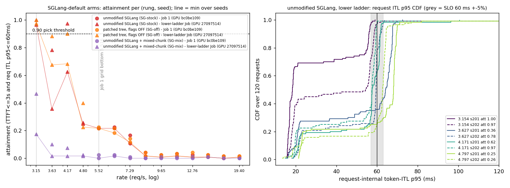
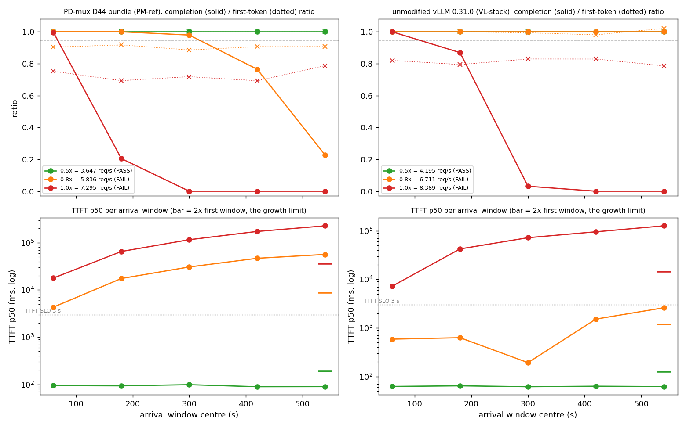

# Phase B 아래쪽 사다리 Job·두 번째 Job(지속 용량) 결과 — 기본 서빙 구조 기준선, VESSL·Nano (2026-11-04, result-analyst)

> 지위: **결과 분석(봉인 규칙 rev3.2 적용만, 새 판정 없음)**. 사전등록 = `PREREG_STOCK_BASE_rev1_DRAFT_2026-11-02.md`(rev3.2 봉인, sha `042514e0…`, `HARNESS_DIGEST.txt` digest `0515bd1a…`) · 사전 예측 = `PREDICTION_phaseB_expected_effects_2026-11-02.md`(sha `5923a533…`) · 하네스 감사 r1·r2·rev3 r1·rev3 r2 · 첫 번째 Job 결과 `RESULT_phaseB_J1_2026-11-03.md`. 감사 전이며 정본 반영은 promote 몫이다.
> 라벨: [측정] raw에서 직접 · [유도] raw에서 계산(봉인 규칙 밖 계산은 표시) · [가정] 검증 안 된 해석.
> arm 이름: 손대지 않은 SGLang(`SG-stock`) · 수정 트리·플래그 OFF SGLang(`SG-off`) · 손대지 않은 SGLang + mixed-chunk(`SG-mix`) · 손대지 않은 vLLM 0.31.0(`VL-stock`) · static PD-mux D44 구성 묶음(`PM-ref`). 아래쪽 사다리 Job = `J1-down`, 두 번째 Job = `J1b`(하네스 식별자).

## 0. 한 줄 판정

**봉인 규칙 출력 그대로(CPU 재현 바이트 일치)**: 아래쪽 사다리를 첫 번째 Job 사다리와 합친 pick 결과 손대지 않은 SGLang·수정 트리 OFF = **3.153791 req/s `BRACKETED`**(아래쪽 바닥 rung이 통과, 바로 위 3.62686에서 끊김), mixed-chunk = **`LADDER_BOTTOM_FAIL_2`**(값 없음). 지속 용량 PD-mux 묶음 **3.647455**(0.5× 점), vLLM **4.194573**(0.5× 점) → 기준 용량 **3.647455 req/s**(min, PD-mux 묶음) → 세 번째 Job 셀 rate **1.823727(50 %)·2.917964(80 %)**. 기준 셀(PD-mux 묶음 7.29491) 시작 0.950·끝 0.892 대 첫 번째 Job 0.967 → **`SUBSTRATE_OK`**(차 < 10 %p).

- 손대지 않은 SGLang 3.15 통과점은 **ITL 축 절벽 위의 통과**다: seed 202는 ITL SLO를 5 % 내리면 0.97 → 0.72, 바로 위 rung 3.63에서 두 seed가 0.36/0.78로 갈리고 4.17 seed 202는 0.975로 되살아난다(비단조). 값은 봉인 규칙 출력으로 서지만 **크기 해석은 `confounded(metric cliff, ITL 축)`**이다(§2-3).
- 지속 탈락의 기전이 두 arm에서 다르다: PD-mux 묶음 0.8×(5.836)은 **두 조건 다** 발화(완료율 마지막 창 0.227 · TTFT 증가 13.1×; 완료 처리율 ≈ 5.15 req/s < 도착 5.84 — 순수 과부하). vLLM 0.8×(6.711)은 **TTFT 증가 조건만** 발화(완료율 다섯 창 전부 1.000, TTFT 중앙 587 → 2599 ms = 4.43×, 창별 비단조 — 임계 부하 근처 요동)(§3).
- 정책 결론: **없음**(사다리 rung당 seed 2, 지속 점당 seed 1·boot 1; 쌍 라벨 미등록 Job). 다음에 필요한 것: 세 번째 Job dry-run(시간 모형 267.2 min > 4 h → 분할 여부 사용자 결정, PREREG §7) + 아래 §5 예보의 공시.

## 1. 대상·재현·스탬프 [측정]

| 항목 | 아래쪽 사다리 Job | 두 번째 Job |
|---|---|---|
| Job | `pdmux-stock-baseline-0e9c967-20261103192557`(커밋 `0e9c967c`) | `pdmux-stock-baseline-6481369-20261103192607`(커밋 `64813699`) |
| 시간(UTC) | 2026-11-03 19:26:20 → 19:53:00(26.7 min; 추정 56.4·캡 75) | 19:53:18 → 21:17:02(83.7 min; 추정 90.8·캡 115) |
| exit · DONE | 0 · boot 3개 전부 `done` | 0 · boot 4개 전부 `done` |
| GPU | A100-SXM4-80GB, UUID **`GPU-27097514-97cf-4981-cd7e-58f7abc4ce12`**, 드라이버 580.178.04, cc 8.0, 400 W, MIG off, 호스트 `job-opa967cax1n7-xq7ss` | **같은 UUID `GPU-27097514…`**, 같은 드라이버, 호스트 `job-90kty1wyzel0-rnqdr`(다른 pod) |
| 첫 번째 Job과 | **다른 GPU**(첫 번째 Job = `GPU-bc0be109…`, 호스트 `job-4ma8ia5u8cfx-n9qbd`) | 다른 GPU(같음) |
| 이미지 | `sglang-vllm-runtime@sha256:a5f9bf0f…`, SGLang freeze `45c39de2…`(두 Job·첫 번째 Job 동일) | 같음; vLLM boot 스탬프 실패 0 |
| 엔진 트리 | digest `2836112b…` match=True · pristine 보존 OK(manifest `1bd84d88…`, 2258항목) · `tree_failures` 0 · `patched_manifest_failures` 0 · `stamp_failures` 0 | 같음(전부 0) |
| plan sha | `c3b473d0…` = `HARNESS_DIGEST.txt` plans_sha J1-down | `d2979338…` = `sb_spec.make_plan("J1b", ADDENDUM_J1_rev3.json)` 로컬 재계산과 일치(봉인 digest의 J1b sha `b015ab38…`는 표준 가상 addendum으로 만든 값이라 다른 것이 정상; 실제 addendum sha `31415087…` = Job의 `addendum.sha256`) |
| raw | `SHA256SUMS` 73/73 OK(로컬 재검사) | 50/50 OK |
| trace | (rate, seed) 8셀마다 3 arm의 trace hash 1개로 동일 | 기준 셀 seed 201 trace hash `eab58f5f…` = 첫 번째 Job 같은 셀 |
| 정확성 검사 | boot 3개 `n_bad` 0 | boot 4개 `n_bad` 0 |
| run 구조 | 전 run segment 1개(라운드 append 없음 → duration 합산 문제 해당 없음) · 요청 오류 0 | 같음 · 오류 0 |
| 서버 설정(로그) | 손대지 않은 SGLang·수정 트리 OFF: chunked 8192, overlap ON, mixed OFF, flashinfer, mem 0.836 · mixed-chunk: + `enable_mixed_chunk=True`(chunked 8192 > 0 → 발화 조건 충족) | PD-mux 묶음: chunked −1, overlap OFF, mem 0.6, mamba cache 48 · vLLM: FLASH_ATTN, CUDAGraphMode FULL_AND_PIECEWISE, prefix caching OFF |
| 순서 | mixed-chunk(19:31–19:37) → 손대지 않은 SGLang → 수정 트리 OFF(–19:53); rung·seed 순서는 boot 안 무작위 | 기준 셀 시작(19:58) → PD-mux 지속 7.29 → 5.84 → 3.65 → vLLM 지속 8.39 → 6.71 → 4.19 → 기준 셀 끝(21:16). **지속 점 순서는 rate 내림차순 고정**(무작위 아님) |

- 두 Job은 **같은 물리 GPU에서 순차로** 돌았다(UUID 동일, 시간 겹침 없음, 다른 pod). 동시 공유 confound는 없다 [측정].
- **CPU 재현**: `sb_analyze.py addendum --j1 <첫 번째 Job raw> --j1down <아래쪽 raw> --j1b <두 번째 raw>` 재실행 출력 sha `f15e5aa6…` = `runs/ADDENDUM_after_J1b.json` sha(**바이트 동일**). `sb_analyze.py report`(같은 세 raw) 오류 없이 종료, 출력은 scratch에만(결과 디렉터리에 쓰지 않음). report 요지: smoke `CLIENT_DEF_OK`(첫 번째 Job 값), `TTFT_OFFSET_UNCHECKED`(세 번째 Job 없음), `kind_problems` 없음, Q1 `PARTIAL`(burst 3.153791, source "J1 + J1-down ladder", 지속 없음), Q2–Q8 `NOT_MEASURED`, P-1·P-2·P-3·P-5 `score: None`, P-4 `UNSCORABLE`(n = 0). 두 번째 Job 보드 위 `SUSTAIN_EVAL.json`과 로컬 `sustain_eval` 재계산 4/4 일치.
- 봉인 파일 14개 + 재사용 21개 sha 전부 `HARNESS_DIGEST.txt`와 일치(로컬 확인).

## 2. 아래쪽 사다리 [측정]

### 2-1. arm × rung × seed attainment (120요청/run; 칸 = seed 201 / 202; 평균 ± SD는 n = 2 [유도])

| rung (req/s) | 손대지 않은 SGLang | 수정 트리 OFF | mixed-chunk |
|---|---|---|---|
| 3.153791 | **1.000 / 0.967** (0.983 ± 0.024) | 1.000 / 0.975 (0.988 ± 0.018) | 0.467 / 0.175 (0.321 ± 0.206) |
| 3.62686 | **0.358 / 0.783** (0.571 ± 0.300) | 0.675 / 0.883 (0.779 ± 0.147) | 0.100 / 0.017 (0.058 ± 0.059) |
| 4.170888 | 0.625 / **0.975** (0.800 ± 0.247) | 0.683 / 0.900 (0.792 ± 0.153) | 0.017 / 0.075 (0.046 ± 0.041) |
| 4.796522 | 0.250 / 0.258 (0.254 ± 0.006) | 0.400 / 0.225 (0.313 ± 0.124) | 0.025 / 0.017 (0.021 ± 0.006) |
| (첫 번째 Job) 5.516 | 0.217 / 0.217 | 0.217 / 0.225 | 0.025 / 0.000 |

봉인 `ladder_down` 출력(첫 번째 Job 점 + 아래쪽 점, 오름차순 pick, 동률 → 낮은 rate): 손대지 않은 SGLang **3.153791 `BRACKETED`** · 수정 트리 OFF **3.153791 `BRACKETED`** · mixed-chunk **`LADDER_BOTTOM_FAIL_2`**. 이 값은 Q1에만 쓰이고 기준 용량·셀 rate에 들어가지 않는다(PREREG §3(가), 봉인 addendum `lambda_star_ref_excluded`).

- 분산 공시(게이트 1): 3.63·4.17 rung의 seed 간 SD 0.15–0.30은 rung 간 차이(3.15 → 3.63 평균 차 0.41)와 같은 크기다. 각 seed는 다른 trace(다른 도착·프롬프트)이고 arm당 boot 1개라 이 SD는 "trace 내용 + 같은 boot 안 잡음"이며 boot 간 잡음은 재지 않았다.
- **비단조**: 손대지 않은 SGLang 4.17 seed 202(0.975) > 3.63 seed 202(0.783) > 3.63 seed 201(0.358). pick 규칙은 3.63 seed 201에서 멈춘다. "3.15와 3.63 사이에 경계가 있다"는 규칙 출력이지 정밀 용량이 아니다.

`figures/j1down_ladder.png` — 볼 것: 왼쪽은 SGLang 3 arm의 attainment(동그라미 = 첫 번째 Job GPU bc0be109, 세모 = 아래쪽 사다리 GPU 27097514, 선 = seed 최솟값). 손대지 않은 SGLang·수정 트리 OFF가 3.15에서만 0.90 선 위에 있고 3.63–4.17에서 seed 간 폭이 큰 것, mixed-chunk는 바닥에서도 0.47 이하인 것. 오른쪽은 손대지 않은 SGLang 요청 내부 ITL p95 CDF — 3.15 seed 201만 대부분이 20 ms대 봉우리에 있고 나머지 run은 회색 띠(57–63 ms) 근처에서 수직 상승한다(절벽).

### 2-2. SLO 항 분해·지연 (칸 = seed 201 / 202; TTFT는 run 단위 p50/p95/p99 ms; "요청 ITL p50/p95 중앙" = 요청별 token-ITL 백분위의 run 중앙값 ms; 실패 수는 120 중) [측정]

| arm | rung | dur s | TTFT p50/p95/p99 | 요청 ITL p50 중앙 | 요청 ITL p95 중앙 | TTFT 실패 | ITL 실패 | 둘 다 | TTFT ≤ SLO 비율 |
|---|---|---|---|---|---|---|---|---|---|
| 손대지 않은 SGLang | 3.1538 | 54.1 / 46.0 | 72/159/313 · 74/169/277 | 15.3 / 16.0 | **18.4 / 54.5** | 0 / 0 | 0 / 4 | 0 / 0 | 1.00 / 1.00 |
| 손대지 않은 SGLang | 3.6269 | 39.4 / 40.0 | 90/323/518 · 84/241/297 | 18.4 / 18.6 | 64.2 / 59.5 | 0 / 0 | 77 / 26 | 0 / 0 | 1.00 / 1.00 |
| 손대지 않은 SGLang | 4.1709 | 41.5 / 40.5 | 80/268/385 · 77/225/381 | 18.4 / 17.7 | 57.5 / 57.5 | 0 / 0 | 45 / 3 | 0 / 0 | 1.00 / 1.00 |
| 손대지 않은 SGLang | 4.7965 | 36.8 / 32.0 | 102/245/354 · 99/524/665 | 20.7 / 21.5 | 68.1 / 62.8 | 0 / 0 | 90 / 89 | 0 / 0 | 1.00 / 1.00 |
| 수정 트리 OFF | 3.1538 | 54.1 / 46.0 | 72/159/237 · 75/166/281 | 15.3 / 16.0 | 18.4 / 53.5 | 0 / 0 | 0 / 3 | 0 / 0 | 1.00 / 1.00 |
| 수정 트리 OFF | 3.6269 | 39.3 / 40.0 | 82/314/460 · 79/244/301 | 18.4 / 18.5 | 57.1 / 58.3 | 0 / 0 | 39 / 14 | 0 / 0 | 1.00 / 1.00 |
| 수정 트리 OFF | 4.1709 | 41.5 / 40.5 | 79/292/378 · 79/226/368 | 18.4 / 17.7 | 57.6 / 58.7 | 0 / 0 | 38 / 12 | 0 / 0 | 1.00 / 1.00 |
| 수정 트리 OFF | 4.7965 | 36.7 / 32.0 | 101/239/349 · 93/567/682 | 20.4 / 21.4 | 61.5 / 62.5 | 0 / 0 | 72 / 93 | 0 / 0 | 1.00 / 1.00 |
| mixed-chunk | 3.1538 | 55.0 / 46.9 | 145/303/396 · 206/481/559 | 15.7 / 17.9 | 61.0 / 73.4 | 0 / 0 | 64 / 99 | 0 / 0 | 1.00 / 1.00 |
| mixed-chunk | 3.6269 | 45.7 / 47.8 | 260/4016/4700 · 379/5676/6255 | 19.8 / 22.0 | 93.4 / 182.3 | 16 / 18 | 99 / 109 | 7 / 9 | 0.87 / 0.85 |
| mixed-chunk | 4.1709 | 49.5 / 46.5 | 344/6291/7070 · 339/3133/4398 | 21.3 / 20.9 | 179.9 / 194.4 | 20 / 7 | 106 / 108 | 8 / 4 | 0.83 / 0.94 |
| mixed-chunk | 4.7965 | 47.1 / 46.5 | 670/8274/9865 · 1732/11323/12357 | 23.9 / 24.1 | 228.0 / 252.7 | 43 / 56 | 103 / 109 | 29 / 47 | 0.64 / 0.53 |

- 손대지 않은 SGLang·수정 트리 OFF의 실패는 이 4 rung에서도 **100 % ITL 항**(TTFT 실패 0, TTFT ≤ SLO 비율 1.00, TTFT 절벽 비율 0.00)이다. mixed-chunk는 3.15에서 ITL 항만, 3.63 이상에서 두 항 모두.
- ★게이트 4 차단형: TTFT ≤ SLO 비율이 0.5 미만인 run은 이 표에 없다(최저 mixed-chunk 4.80 seed 202 0.53). 이 사다리는 판정 셀이 아니므로 어느 구간에서도 **arm 간 % 크기를 쓰지 않는다**.

### 2-3. ITL 축 절벽 진단 (첫 번째 Job §6-3과 같은 방식) [측정 분포 + 진단용 유도]

요청 내부 ITL p95의 60 ms 근방 비율(120요청 중)과 토큰 ITL 두 모드(간극 = 40 ms 초과 토큰):

| arm · rung · seed | ≤ 60 | 55–65 | 57–63 (±5 %) | 60–70 | > 70 | 간극 토큰 비율 | 간극 p50 (p10–p90) ms | 기본 모드 p50 ms |
|---|---|---|---|---|---|---|---|---|
| 손대지 않은 SGLang · 3.1538 · 201 / 202 | 1.00 / 0.97 | 0.22 / 0.47 | 0.03 / **0.28** | 0.00 / 0.03 | 0.00 / 0.01 | 0.041 / 0.051 | 57.1 (55.4–64.1) / 58.0 (56.0–62.2) | 15.4 / 15.9 |
| 손대지 않은 SGLang · 3.6269 · 201 / 202 | 0.36 / 0.78 | 0.19 / 0.74 | 0.09 / 0.72 | 0.63 / 0.22 | 0.01 / 0.00 | 0.069 / 0.068 | 66.9 (62.2–118.2) / 60.9 (58.6–106.2) | 18.1 / 18.3 |
| 손대지 않은 SGLang · 4.1709 · 201 / 202 | 0.62 / 0.97 | 0.74 / 0.68 | 0.68 / 0.62 | 0.36 / 0.02 | 0.02 / 0.01 | 0.069 / 0.065 | 60.6 / 58.8 | 18.1 / 17.5 |
| 손대지 않은 SGLang · 4.7965 · 201 / 202 | 0.25 / 0.26 | 0.14 / 0.78 | 0.04 / 0.34 | 0.71 / 0.71 | 0.04 / 0.03 | 0.079 / 0.099 | 68.6 / 63.0 | 20.3 / 21.3 |
| 수정 트리 OFF · 3.1538 · 201 / 202 | 1.00 / 0.97 | 0.16 / 0.47 | 0.02 / 0.30 | 0.00 / 0.02 | 0.00 / 0.01 | 0.041 / 0.051 | 57.1 / 58.9 | 15.4 / 15.9 |
| 수정 트리 OFF · 3.6269 · 201 / 202 | 0.68 / 0.88 | 0.65 / 0.74 | 0.50 / 0.70 | 0.33 / 0.12 | 0.00 / 0.00 | 0.068 / 0.068 | 60.8 / 59.7 | 18.0 / 18.2 |
| mixed-chunk · 3.1538 · 201 / 202 | 0.47 / 0.17 | 0.30 / 0.07 | 0.15 / 0.04 | 0.50 / 0.18 | 0.03 / 0.64 | 0.063 / 0.103 | 66.8 / 72.7 | 15.7 / 17.6 |

**진단용 SLO 섭동**(ITL SLO만 바꾸고 TTFT 3 s 유지; ★재스코어 결론 아님 — 게이트 7. "절벽인가"의 판정 근거로만 쓰고 수치 인용 금지):

| arm · rung · seed | 54 | 57 | **60(등록)** | 63 | 66 | 70 ms |
|---|---|---|---|---|---|---|
| 손대지 않은 SGLang · 3.1538 · 201 | 0.76 | 0.97 | **1.00** | 1.00 | 1.00 | 1.00 |
| 손대지 않은 SGLang · 3.1538 · 202 | 0.49 | 0.72 | **0.97** | 0.99 | 0.99 | 0.99 |
| 손대지 않은 SGLang · 3.6269 · 201 | 0.34 | 0.35 | **0.36** | 0.44 | 0.64 | 0.99 |
| 손대지 않은 SGLang · 3.6269 · 202 | 0.26 | 0.26 | **0.78** | 0.97 | 1.00 | 1.00 |
| 손대지 않은 SGLang · 4.1709 · 201 / 202 | 0.23 / 0.29 | 0.31 / 0.38 | **0.62 / 0.97** | 0.98 / 0.99 | 0.98 / 0.99 | 0.98 / 0.99 |
| 수정 트리 OFF · 3.1538 · 201 / 202 | 0.76 / 0.50 | 0.98 / 0.69 | **1.00 / 0.97** | 1.00 / 0.99 | 1.00 / 0.99 | 1.00 / 0.99 |
| mixed-chunk · 3.1538 · 201 / 202 | 0.42 / 0.17 | 0.44 / 0.17 | **0.47 / 0.17** | 0.59 / 0.22 | 0.77 / 0.24 | 0.97 / 0.36 |

**3.15 통과점의 성격(공시)** [유도]:
1. 간극 모드 길이가 3.15에서 57–59 ms로 **SLO 60 ms 바로 아래**(−2~−5 %)이고, rate가 오르면 61–69 ms로 SLO를 넘는다. 간극 토큰 비율은 3.15에서 4.1–5.1 %로 p95 술어 허용분 5 %를 **가로지른다**(seed 201 4.1 % → 요청 대부분의 p95가 기본 모드 안 → 요청 ITL p95 중앙 18.4 ms; seed 202 5.1 % → 간극 모드 경계 → 54.5 ms).
2. seed 202는 ITL ±5 % 띠 비율 0.28(> 10 %)로 절벽 위에 있고, SLO −5 %에서 0.97 → 0.72. seed 201은 띠 비율 0.03이나 SLO −10 %(54)에서 0.76.
3. 따라서 3.15 `BRACKETED`는 봉인 규칙의 정당한 출력이지만 **"손대지 않은 SGLang 기본 구성의 버스트 용량이 약 3.15 req/s"라는 크기 해석은 `confounded(metric cliff, ITL 축)`**다. 통과 여부가 seed(trace)·SLO의 수 % 섭동에 달려 있다.
4. 등록 cliff 검사(유효성 사슬 ②)는 TTFT 축만 보므로 이 절벽을 잡지 못한다(첫 번째 Job에서 공시한 사각 그대로; 새 규칙을 만들지 않는다).
5. mixed-chunk 3.15 seed 202는 SLO +17 %(70 ms)에서도 0.36 — 절벽이 아니라 실패다. seed 201은 66–70 ms에서 0.77–0.97로 오른다(부분 절벽).

## 3. 지속 셀 [측정; 판정 = 봉인 `sustain_eval`]

규칙(PREREG §3 rev2): 도착 120 s 창 w = 0..4, 600 s 이후 도착 제외. 통과 = 다섯 창 모두 완료율(E2E ≤ 60 s 완료 ÷ 창 도착) ≥ 0.95 **이고** 마지막 창 TTFT 중앙 ≤ 첫 창의 2배. 첫 토큰 비율은 보고 열. 모든 점 seed 201·boot 1개(n = 1).

### 3-1. 점별 요약

| arm | 배수 · rate | 요청 / 600 s 이후 제외 | 통과 | 완료율 조건 | TTFT 증가(마지막/첫 창) | 전체 attainment | TTFT p50/p95/p99 ms | 요청 ITL p50 / p95 중앙 ms | 완료 처리율 req/s | E2E p50 / p95 s | throttle 비율 |
|---|---|---|---|---|---|---|---|---|---|---|---|
| PD-mux 묶음 | 0.5 · 3.647455 | 2188 / 132 | **PASS** | 충족(최소 1.000) | 0.95 | 1.000 | 92 / 424 / 679 | 20.0 / 42.0 | 3.41 | 5.9 / 16.3 | 0.091 |
| PD-mux 묶음 | 0.8 · 5.835928 | 3502 / 33 | FAIL | **미달(최소 0.227)** | **13.06** | 0.081 | 31253 / 59064 / 62676 | 26.0 / 49.4 | 5.15 | 41.0 / 71.0 | 0.147 |
| PD-mux 묶음 | 1.0 · 7.29491 | 4377 / 0 | FAIL | 미달(최소 0.000) | 12.76 | 0.034 | 114745 / 235613 / 243956 | 26.2 / 49.6 | 5.19 | 122.5 / 244.4 | 0.152 |
| vLLM | 0.5 · 4.194573 | 2517 / 0 | **PASS** | 충족(최소 1.000) | 0.99 | 0.996 | 62 / 178 / 271 | 16.7 / 39.0 | 4.13 | 4.8 / 13.0 | 0.111 |
| vLLM | 0.8 · 6.711317 | 4027 / 48 | FAIL | **충족(다섯 창 1.000)** | **4.43** | 0.869 | 976 / 3562 / 4917 | 21.6 / 44.9 | 6.52 | 7.4 / 18.8 | **0.233** |
| vLLM | 1.0 · 8.389146 | 5033 / 79 | FAIL | 미달(최소 0.000) | 17.55 | 0.036 | 72504 / 135223 / 137888 | 21.7 / 45.4 | 6.61 | 78.6 / 141.9 | 0.242 |

봉인 출력: PD-mux 묶음 지속 λ\* = **3.647455**, vLLM = **4.194573**(둘 다 조건부 0.5× 점이 통과, 상태 OK). 지속/버스트 비 = PD-mux 0.5 · vLLM 0.5(격자점) [측정].
★게이트 4 차단형: TTFT ≤ SLO 비율이 0.5 미만인 점(PD-mux 0.8×·1.0×, vLLM 1.0×)은 과부하 구간이며 attainment·goodput은 run 길이 의존(ill-posed)이다. 이 문서는 지속 점 사이 arm 간 % 크기를 쓰지 않는다.

### 3-2. 창별 표 (창 = 도착 120 s; "완료율" = E2E ≤ 60 s 완료 ÷ 창 도착, "첫 토큰" = 창 안 첫 토큰 ÷ 창 도착, "처리율" = 창 안 완료 수 ÷ 120 s)

| arm · 배수 | 창 | 도착(명목) | 완료율 | 첫 토큰 | attainment | TTFT p50 / p95 ms | TTFT ≤ SLO | E2E p50 / 최대 s | 요청 ITL p95 중앙 | 처리율 |
|---|---|---|---|---|---|---|---|---|---|---|
| PD-mux 0.5 | 0–4 | 395–420 (438) | 1.000 ×5 | 1.000 ×5 | 1.000 ×5 | 89–98 / 396–504 | 1.000 | 5.4–6.3 / 19.9–28.1 | 41.5–43.6 | 3.15–3.49 |
| PD-mux 0.8 | 0 | 676 (700) | 1.000 | 0.904 | 0.422 | 4325 / 12190 | 0.422 | 12.8 / 37.7 | 49.2 | 4.72 |
| | 1 | 667 | 1.000 | 0.918 | 0.000 | 17458 / 20736 | 0.000 | 25.3 / 48.6 | 49.3 | 5.11 |
| | 2 | 731 | 0.979 | 0.886 | 0.000 | 30634 / 38527 | 0.000 | 39.0 / 80.4 | 49.3 | 5.37 |
| | 3 | 685 | **0.765** | 0.907 | 0.000 | 46768 / 51283 | 0.000 | 54.3 / 76.5 | 49.4 | 5.17 |
| | 4 | 710 | **0.227** | 0.907 | 0.000 | 56468 / 62631 | 0.000 | 64.7 / 88.7 | 49.7 | 5.38 |
| PD-mux 1.0 | 0 / 1 / 2–4 | 871 / 914 / 772–921 (875) | 0.997 / 0.205 / 0.000 | 0.69–0.79 | 0.171 / 0 / 0 | 17836 → 227551 (p50) | 0.171 → 0 | 26.1 → 236.2 | 49.4–50.0 | 5.06–5.38 |
| vLLM 0.5 | 0–4 | 489–518 (503) | 1.000 ×5 | 0.998–1.002 | 0.988–1.000 | 61–64 / 143–211 | 1.000 | 4.4–5.0 / 17.4–19.3 | 38.6–39.6 | 3.91–4.44 |
| vLLM 0.8 | 0 | 771 (805) | 1.000 | 0.999 | 0.982 | **587** / 2359 | 0.996 | 6.7 / 22.4 | 45.0 | 6.17 |
| | 1 | 837 | 1.000 | 1.000 | 0.860 | 628 / 4537 | 0.866 | 7.1 / 29.4 | 44.9 | 6.83 |
| | 2 | 770 | 1.000 | 0.994 | 0.991 | 192 / 1756 | 0.999 | 6.7 / 35.1 | 44.9 | 6.38 |
| | 3 | 795 | 1.000 | 0.981 | 0.930 | 1519 / 3102 | 0.942 | 7.5 / 29.9 | 45.1 | 6.50 |
| | 4 | 806 | 1.000 | 1.021 | 0.586 | **2599** / 4101 | 0.609 | 8.6 / 30.9 | 44.9 | 6.86 |
| vLLM 1.0 | 0 / 1 / 2 / 3–4 | 971–1003 (1007) | 1.000 / 0.869 / 0.031 / 0.000 | 0.79–0.83 | 0.184 / 0 … | 7235 → 126961 (p50) | 0.185 → 0 | 15.9 → 135.0 | 45.2–45.9 | 6.42–6.88 |

`figures/j1b_sustain_windows.png` — 볼 것: 위 줄 완료율(실선)·첫 토큰 비율(점선)과 0.95 선, 아래 줄 창별 TTFT 중앙(로그)과 오른쪽 끝 막대(= 첫 창의 2배, 증가 한계). PD-mux 0.8×(주황)은 첫 토큰 비율이 처음부터 약 0.9에 붙어 있고 TTFT가 창마다 선형 누적되어 완료율이 마지막 두 창에서 무너진다. vLLM 0.8×는 완료율이 끝까지 1.0인데 TTFT 중앙만 비단조로 오르내리다 마지막 창에서 막대를 넘는다.

### 3-3. 두 0.8× 탈락의 차이 (기술)

- **PD-mux 묶음 0.8×(5.836)**: 규칙의 **두 조건이 모두 발화**했다. 첫 토큰 비율이 첫 창부터 0.89–0.92 = 입장 속도 ≈ 0.9 × 5.84 ≈ 5.25 req/s, 창별 완료 처리율 4.72–5.38(전체 5.15) req/s로 도착 5.84보다 작다 [측정·유도]. 대기열이 창마다 쌓여 TTFT 중앙이 4.3 → 17.5 → 30.6 → 46.8 → 56.5 s로 거의 선형 증가하고, E2E가 60 s 한도를 넘는 창 3·4에서 완료율이 0.765·0.227로 떨어진다. 요청 ITL p95 중앙은 49.2–49.7 ms로 창 내내 거의 일정 — 실패는 전부 TTFT(대기열) 항이다. **순수 과부하(도착 > 서비스)**의 모양.
- **vLLM 0.8×(6.711)**: **TTFT 증가 조건만 발화**했다(완료율 다섯 창 1.000, 첫 토큰 비율 0.98–1.02, 창별 처리율 6.17–6.86 ≈ 도착). TTFT 중앙은 587 → 628 → 192 → 1519 → 2599 ms로 **비단조**이고 E2E 최대는 22–35 s로 60 s 한도 아래다. 처리율이 도착과 거의 같은 **임계 부하(ρ ≈ 1) 근처의 대기열 요동**으로 읽힌다 [가정]. 이 점의 전체 attainment 0.869(창 0.586–0.991), TTFT 절벽 비율 0.027 — 성장 비 4.43은 첫 창 중앙(587 ms) 대비의 비라 작은 기준값에 민감하다. 이 점은 throttle 표본 0.233(이 Job 최고 수준) 아래에서 잰 것이다.
- 즉 두 arm의 "지속 용량 = 0.5× 점"은 같은 격자 결과지만, PD-mux 묶음은 0.8×가 서비스율 밖(≈ 5.15 < 5.84), vLLM은 0.8×가 서비스율 경계(≈ 6.5–6.6 ≈ 6.71)라는 다른 위치에서 나왔다 [유도]. 실제 지속 경계는 PD-mux (3.65, 5.84), vLLM (4.19, 6.71) 구간 안 어딘가이며 격자가 더 촘촘하지 않아 정해지지 않는다(인용 금지 6 승계).
- 버스트 λ\*(120요청)와 포화 완료 처리율의 비 [유도]: PD-mux 7.29 / ≈ 5.15–5.19 ≈ 1.4, vLLM 8.39 / ≈ 6.5–6.6 ≈ 1.27. 120요청 버스트는 대기열이 쌓이기 전에 끝나므로 서비스율보다 높은 rate를 통과시킨다 [가정 — 기전 미측정].

### 3-4. 사전 예측 문서 기술 행과의 대조 [기술 — 채점 아님, 인용 금지 9]

| 기술 예측 행 | 예측 | 관측 | 비고 |
|---|---|---|---|
| 지속/버스트, PD-mux D44 | 0.5("포화 완료율 5.06–5.34 < 0.8 × 7.29 = 5.84이므로 0.8점 탈락 예상") | 0.5; 0.8× 점의 완료 처리율 5.15(창 4.72–5.38) | 격자점 일치와 근거 수치의 정합만 기술. 등록 추정량 아님 |
| 지속/버스트, 손대지 않은 SGLang | 0.8 | **측정 안 함**(rev3에서 SG 3 arm 지속 셀 제외) | — |
| 지속/버스트, vLLM | (행 없음) | 0.5 | 예측 대상 아님 |

## 4. 기준 셀·기판 공변량 [측정; 판정 = 봉인 `substrate`]

### 4-1. 기준 셀 (PD-mux 묶음, 7.29491 req/s, seed 201, 120요청, trace `eab58f5f…`)

| 셀 | attainment | TTFT p50/p95/p99 ms | TTFT 실패 / ITL 실패 | TTFT 절벽 비율(SLO ±5 %) | 요청 ITL p50 / p95 중앙 | 간극 비율 · p50 | throttle | SM MHz p50/p5 | 전력 W 평균/p95 |
|---|---|---|---|---|---|---|---|---|---|
| 첫 번째 Job(GPU bc0be109) seed 201 | 0.967 | 418 / 2910 / 3254 | 4 / 0 | 0.050 | 25.8 / 48.7 | 0.165 · 46.3 | 0.081 | 1410/1395 | 326/390 |
| (참고) 첫 번째 Job seed 202 | 1.000 | 363 / 2695 / 2886 | 0 / 0 | 0.033 | 25.9 / 47.5 | 0.202 · 45.4 | 0.103 | 1410/1395 | 329/394 |
| 두 번째 Job 시작(GPU 27097514) | 0.950 | 422 / 2985 / 3302 | 6 / 0 | 0.075 | 25.7 / 48.9 | 0.168 · 46.1 | 0.074 | 1410/1395 | 325/391 |
| 두 번째 Job 끝 | 0.892 | 382 / 3146 / 3470 | 13 / 0 | 0.075 | 25.9 / 49.5 | 0.171 · 48.6 | 0.098 | 1410/1395 | 328/393 |

봉인 출력: **`SUBSTRATE_OK`**(시작 −0.017, 끝 −0.075 %p 차; 문턱 10 %p) [측정].
- 기준 셀 자체가 **TTFT 절벽 위**다(TTFT가 SLO ±5 % 안 5–7.5 %, 실패는 전부 TTFT 항). 끝 셀의 0.892는 pick 문턱 0.90 아래이고, 첫 번째 Job 사다리에서 같은 값이 나왔다면 PD-mux 묶음 버스트 λ\*는 한 rung 아래였을 것이다 [유도]. 기준 셀 감도는 낮다(인용 금지 15 승계).
- 기준 셀은 PD-mux 묶음 용량 쪽만 본다. **손대지 않은 SGLang의 기판 이동(간극 길이)은 어느 Job에서도 기준 셀로 재지 않았다.** 아래쪽 사다리 Job은 기준 셀이 없다. 같은 물리 GPU에서 약 5.6 분 뒤 시작한 두 번째 Job의 시작 기준 셀은 등록 규칙상 아래쪽 사다리의 눈금이 아니다(시간·GPU 근접 사실만 기술).

### 4-2. Job별 클럭·throttle (`raw/clk` 100 ms 표본; throttle = GpuIdle 비트 제외, 사유 비트는 세 Job 모두 `0x4` SW power cap뿐)

| Job | GPU | 표본 | throttle 비율 | `SUBSTRATE_WARNING` |
|---|---|---|---|---|
| 첫 번째 | bc0be109 | 44983 | 0.030 | 없음 |
| 아래쪽 사다리 | 27097514 | 15723 | 0.002 | 없음 |
| 두 번째 | 27097514 | 49873 | **0.139** | 없음 |

- 아래쪽 사다리 arm별(부하 창): 손대지 않은 SGLang 0.008 · 수정 트리 OFF 0.003 · mixed-chunk 0.000; SM MHz p50/p5 1410/1410; 전력 평균 300–326 W; 최고 59 °C. 첫 번째 Job SG 3 arm(0.000–0.005)과 같은 수준 [측정].
- 두 번째 Job 점별 throttle 0.074–0.242(vLLM 0.8×·1.0× 0.233·0.242가 최고), SM p5 1365–1395 MHz. 첫 번째 Job의 vLLM(0.123)·PD-mux 묶음(0.092)보다 높다 — **vLLM 지속 점은 SW power cap 표본 약 23 % 아래에서 잰 값**이다(공시) [측정].
- **기판 판정**: 아래쪽 사다리 3 arm 서로, 두 번째 Job 두 arm 서로는 같은 Job·같은 GPU라 기판 confound 없음. **Q1 값(첫 번째 Job 점 + 아래쪽 점)은 서로 다른 GPU(bc0be109 · 27097514)의 점을 한 pick 규칙으로 합친 것**이라 `confounded(기판)` 성격을 띤다 — 등록 설계가 이미 그렇게 정했고(인용 금지 14), 겹치는 rung이 없어 두 GPU의 SG 간극 길이를 직접 대조할 수 없다. [유도] 인접 rung 대조: 첫 번째 Job 5.516의 간극 p50 63.7–66.4 ms · 기본 모드 20.9–22.4 ms, 아래쪽 4.80의 63.0–68.6 · 20.3–21.3 ms — 같은 자리(정량 동일성 근거 아님). KISTI 수치와 섞지 않았다.

## 5. 세 번째 Job 셀 rate와 그 rate에서의 예보 [유도 — 등록 예측 아님, 채점 대상 아님]

`sb_spec.make_plan("J2", ADDENDUM_after_J1b.json)` 로컬 실행: 셀 rate **R1 = 1.823727 · R2 = 2.917964 req/s**(기준 셀 7.29491), boot 21, 시간 모형 **267.2 min(하드캡 335)**, plan sha `d6d1e525…`, `plan_problems` 없음, pending 1건(vLLM 프로파일러 창 미구현). **267.2 min은 규약 "≲ 4 h"를 넘는다** — PREREG §7: dry-run 출력으로 공시하고 분할 여부는 사용자 결정(쌍은 같은 Job 유지 조건).

각 arm 자기 용량 대비 위치와 이 데이터가 예보하는 attainment:

| arm | 근거 점(이 캠페인) | R1 1.82 위치 | R2 2.92 위치 | 예보 |
|---|---|---|---|---|
| PD-mux 묶음 | 지속 3.647(600 s) 창 attainment 1.000 ×5; 첫 번째 Job 5.516 1.000/0.992 | 지속 λ\*의 0.50 | 0.80 | 두 셀 모두 ≈ 1.0 [가정: rate↓ → attainment 비감소] |
| vLLM | 지속 4.195 창 0.988–1.000(전체 0.996); 첫 번째 Job 5.516 1.000/1.000 | 지속 λ\*의 0.43 | 0.70 | 두 셀 모두 ≈ 1.0 |
| PD-mux D34 구성 | 이 캠페인 측정 없음(CAP1-R 6.343 승계, 다른 GPU) | — | — | 미상 [가정: 포화] |
| 손대지 않은 SGLang(및 복제 boot) | 버스트 3.154: 1.000/0.967; 3.63: 0.36/0.78 | 버스트 λ\*의 0.58 | **0.93** | R1: 포화(≥ 0.98) 가능성 높음. **R2: 미정** — 3.15에서 이미 seed 하나가 0.967(< 0.98)이고 간극 길이 57–59 ms·간극 비율 4–5 %가 SLO·p95 허용분 바로 아래 → R2는 SG의 ITL 절벽 근방 |
| 수정 트리 OFF | 3.154: 1.000/0.975 | 0.58 | 0.93 | 손대지 않은 SGLang과 같음 |
| mixed-chunk | 3.154: 0.467/0.175 | — | — | R2: 미포화(실패) 가능성 높음; R1 미상(관측 없음) |

- R1·R2 run은 200요청 × seed 1–4(사다리 120요청 × seed 201·202와 다른 trace)이고, 다른 GPU일 수 있다. 위 예보는 이 차이를 반영하지 않는다.
- **재감사 rev3 r2 예보 갱신(기술)**:
  - "Q4(PD-mux 묶음 대 vLLM)는 두 W1 셀 모두 `BOTH_SATURATED`" — **유지(근거 강화)**: 두 arm 모두 R2가 자기 지속 λ\*의 0.70–0.80이고, 지속 0.5× 점(600 s)에서 이미 창 attainment ≥ 0.988.
  - "Q2·Q3·Q5·Q8 셀마다 약 60 % BOOT_NOISE"는 SG가 **자기 ITL 용량 위**(≥ 5.516)라는 전제였다. 새 rate에서 SG는 R1에서 자기 버스트 λ\* 아래, R2에서 바로 그 경계(0.93×)다. 따라서 R1에서는 Q2·Q3·Q8 쌍도 `BOTH_SATURATED`가 될 수 있고(그때 goodput 라벨 없음 → 지연 공동 지표만), R2에서는 SG 플라시보(복제 boot 대 손대지 않은 SGLang)가 ITL 절벽 위에서 재지므로 seed 간 폭(3.63에서 0.36/0.78)을 보면 K3 무효(`BOOT_NOISE`) 가능성이 여전히 크다 [가정]. Q5는 mixed-chunk가 R2에서 미포화일 가능성이 높아 `BOTH_SATURATED`가 아닌 부호 라벨이 나올 수 있다(크기 인용 금지 그대로).
  - 정본 승격 goodput 라벨이 사실상 0이라는 예보는 바뀌지 않는다(Q4 = 포화, 나머지 = 부호 전용).
- 검출력 공시 승계: R2의 SG 쪽은 절벽 근방이므로 R2 SG 관련 부호 라벨에도 게이트 4(절벽) 범위 공시가 필요하다.

## 6. 사전 예측 채점 [봉인 `score_predictions` 출력 그대로]

| 예측 | 띠 | 채점 입력(봉인 규칙) | 봉인 스코어러 출력 | 비고 |
|---|---|---|---|---|
| P-1 손대지 않은 SGLang 버스트 λ\* | [6, 10] req/s | **첫 번째 Job 사다리 값만** = None(`LADDER_BOTTOM_FAIL`) | `score: None`, value None | rev3.1 §8: 아래쪽 값으로 다시 채점하지 않는다. 판단(MISS로 옮길지)은 첫 번째 Job 결과 문서와 같이 감사·사용자 결정 |
| P-2 vLLM / 손대지 않은 SGLang 버스트 λ\* | [0.8, 1.25] | 첫 번째 Job 값만 = 분모 None | `score: None` | 같음 |
| P-3·P-5 | — | 세 번째 Job 몫 | None | — |
| P-4 | ±30 % | 계측 boot 합성 창 없음 | `UNSCORABLE`(n = 0) | 실패 아님 |

[기술] 비채점 대조(인용 금지 9·14): 아래쪽 사다리를 합친 손대지 않은 SGLang 버스트 값 3.153791은 P-1 띠 [6, 10] 밖(아래)이고, vLLM 8.389146 / 3.153791 = 2.66은 P-2 띠 밖(위)이다 — 둘 다 서로 다른 GPU의 값을 합친 비이며 등록 채점이 아니다. 지속/버스트 기술 행은 §3-4.

## 7. 게이트 대조·판정

| 게이트 | 상태 |
|---|---|
| 1 n ≥ 4 · baseline 분산 먼저 | 사다리 rung당 n = 2, 지속 점 n = 1(등록 설계). 정책 결론 없음 → 위반 아님. arm 간 비교는 전부 **underpowered(기술값)**. 3.63·4.17 rung seed 간 SD 0.15–0.30 공시 |
| 2 3 % 미만 headline 금지 | 쌍 라벨·effect % 없음(이 두 Job에 쌍 판정 없음) |
| 3 stationary r8 단독 비교 금지 | 정책 비교 아님(용량 측정; 변화 trace는 rev1에서 제거) |
| 4 metric cliff | TTFT 축: 아래쪽 사다리 SG 계열 0.00–0.03; 기준 셀 0.05–0.075(절벽 위). **ITL 축: 손대지 않은 SGLang·수정 트리 OFF 3.15–4.80 전 rung 절벽 위(±5 % 띠 0.02–0.74)** — 등록 검사의 사각. TTFT ≤ SLO < 0.5 구간(지속 PD-mux 0.8×·1.0×, vLLM 1.0×)은 크기 열 비움 준수 |
| 5 duration 합산 | 전 run segment 1개 → 해당 없음 |
| 6 dynamic 병기 | dynamic arm 없음. TTFT p50/p95/p99·요청 ITL p50/p95 병기 |
| 7 SLO 재스코어 금지 | §2-3 섭동표는 절벽 진단 전용 |
| 기판 | Job 안 비교는 같은 GPU. **Q1 합친 값은 두 GPU 혼합**(인용 금지 14). 두 번째 Job throttle 13.9 %(vLLM 점 23–24 %) 공시. KISTI 수치와 섞지 않음 |
| 구성 묶음 | PD-mux 묶음 대 vLLM의 지속 용량 순서는 PD-mux 단독 효과가 아니다(인용 금지 1) |

**판정**: (1) 손대지 않은 SGLang·수정 트리 OFF 버스트 3.153791 `BRACKETED`, mixed-chunk `LADDER_BOTTOM_FAIL_2`, 지속 PD-mux 묶음 3.647455·vLLM 4.194573, 기준 용량 3.647455, 기준 셀 `SUBSTRATE_OK` = **봉인 규칙 출력으로 실재(CPU 재현 바이트 일치)**. (2) 손대지 않은 SGLang·수정 트리 OFF 3.15의 **크기 해석 = `confounded(metric cliff, ITL 축)` + `confounded(기판, 두 GPU 합침)`**. (3) 지속 용량 값 = 격자 하단 점(실제 경계 미분해) — 크기 해석은 **underpowered(n = 1, 격자 3점)**. (4) 세 번째 Job은 등록 규칙상 **제출 가능**(plan 문제 0) — 단 4 h 초과는 사용자 결정.

## 8. 인용 금지 문장

**PREREG §9 승계(문자 그대로)**:
1. "이 캠페인의 PD-mux 대 stock 라벨은 PM-ref 구성 묶음(D44 또는 D34, mem 0.6, overlap OFF, chunked prefill 끔, cap 48, budget 65536, 모두 KISTI 승계) 대 SGLang 기본값의 비교이며, PD-mux 단독 효과도 static PD-mux 최적도 아니다."
2. "판정 셀 rate는 다른 Job(다른 GPU)에서 잰 지속 용량에서 왔고, 지속 점 격자 {1.0, 0.8, 0.5}가 최솟값 arm을 정할 수 있으므로, 셀의 상대 부하는 arm·Job마다 다르다. 기준 셀 비교는 용량 경계 rung에서 잰 것이라 기판 동일성의 증거가 아니다."
3. "두 엔진의 TTFT 시간 기준은 저부하 셀에서만 확인됐고 ITL 측정의 동등성은 확인되지 않았다. 엔진 간 쌍의 EQUIV는 n=4에서 사실상 도달 불가다(sd 예보 0.02 > 0.0186)."
4. "Q8 결과는 이 셀의 goodput·지연 범위에서만 성립하며, 수정 트리 OFF가 커널 수준에서 upstream과 같다는 근거가 아니다(causal_conv1d int64는 코드상 다름)."
5. "W3 셀 rate는 SG-stock 용량만으로 정했으므로, PD-mux arm이 그 rate에서 용량 위였다면 W3 라벨은 부호만 인용하고 크기는 인용하지 않는다. r_ser·T_dec는 수정 트리·플래그 OFF 계측 boot 범위다."
6. "지속 용량은 'E2E ≤ 60 s 완료 ≥ 0.95 ∧ TTFT 중앙 증가 ≤ 2배'로 정한 안정성 경계이며 SLO goodput 용량이 아니다. 이 규칙은 용량 아래 모형과 명백한 과부하 raw 두 극에서만 검증됐고, 지속 격자 {1.0, 0.8, 0.5} 위의 값만 가질 수 있다."
7. "어느 seed든 attainment 0.971–0.98에서 나온 EQUIV_WITHIN_3PCT는 attainment 차가 3% 안에 묶여 거의 구조적으로 나오므로 동등성 근거가 아니다."
8. "지연 공동 지표 라벨에는 지연 플라시보가 적용되지 않았다. boot 간 지연 잡음의 크기는 판정에 들어가지 않는다."
9. "사전 예측 문서에서 P-1–P-5 밖의 행은 추정량과 arm이 등록되지 않은 사후 채점이므로 사전등록 적중으로 인용하지 않는다."
10. "손대지 않은 SGLang은 이 이미지(py3.14)에서 piecewise CUDA graph를 켤 수 없어 prefill이 eager로 돈다(B2 부팅 실패). vLLM 0.31.0은 piecewise CUDA graph ON이다. 따라서 vLLM 대 SGLang 비교와 SGLang의 도착당 정지(~42 ms)에는 'SGLang eager prefill' 환경 범위가 붙으며, 정지 길이 중 eager 발행 비용의 몫은 분리되지 않았다."
11. "손대지 않은 SGLang·패치 OFF·mixed-chunk의 버스트 용량(SLO TTFT 3 s ∧ ITL p95 60 ms)은 5.516 req/s 이상 격자에 없다(첫 번째 Job, ITL 축 절벽)"
13. "판정 셀 rate는 첫 번째 Job에서 손대지 않은 SGLang의 실패를 본 뒤 정한 기준 용량 정의(rev3, SG 제외)에서 나왔으므로, 80% 셀 rate가 5.516 req/s 이상이면 P-3의 HIT(+)는 첫 번째 Job 데이터로 이미 정해진 결과이며 사전등록 적중으로 인용하지 않는다."
14. "Q1의 SGLang 버스트 λ\*는 첫 번째 Job(GPU bc0be109)의 5.516 이상 점과, 기준 셀이 없는 아래쪽 사다리 Job(다른 GPU일 수 있음)의 점을 한 pick 규칙으로 합친 값이며, 아래쪽 rung은 첫 번째 Job 결과를 본 뒤 정했다."
15. "rev3 기준 셀(PM-ref 7.29491 req/s)은 PM-ref 용량 쪽 기판 저하(약 10% 이상)만 잡고, 빨라진 기판(최대 차 0.033)과 손대지 않은 SGLang의 도착당 정지 길이 이동(PM-ref 간극 45 ms는 SLO에서 25% 떨어져 있음)은 잡지 못한다."
- 검출력 공시(rev3 r1): "판정 셀의 플라시보(SG-rep 대 SG-stock)는 SG가 자기 ITL 용량 위에 놓일 수 있는 rate에서 잰다. 첫 번째 Job proxy sd 0.113은 등록 예보 0.006의 19배이므로, BOOT_NOISE 셀은 기판 잡음의 증거로 인용하지 않는다."
- Q4 caveat 5개 = 상한. 하나 더 붙으면 Q4는 정본에 올리지 않고 설계 재작성(감사 r1).
16. "VL-stock과 PM-ref34의 boot 간 잡음은 이 캠페인 어디에서도 재지 않았다. Q3(vLLM 대 SGLang)은 SGLang 쪽 플라시보만, Q4(PD-mux 대 vLLM)는 PD-mux D44 쪽 플라시보(PM-rep 대 PM-ref)만 통과 조건으로 쓰므로, Q3·Q4의 부호·라벨에는 vLLM boot 하나의 우연이 섞일 수 있고, PM-ref34 쌍은 D44 복제로 대신 검사됐다."
- 검출력 공시(rev3 r2): "첫 번째 Job에서 PM-ref와 VL-stock은 판정 셀 rate 범위(5.836 req/s 이하)에서 두 seed 모두 attainment 1.00이었으므로, Q4는 두 W1 셀 모두 BOTH_SATURATED가 예상 결과다. PD-mux 플라시보 sd 예보는 등록되지 않았다."
- (PREREG에 12번 문장은 없다 — 번호 결번 그대로 승계.)

**첫 번째 Job 결과 문서의 제안 문장(감사 확정 전, 승계)**: 그 문서 §10의 10–14(ITL 축 절벽 크기 주장 금지 · "decode step ~60 ms" 불일치 · 사다리 arm 간 차 = 기술값 · 수정 트리 OFF ≈ 손대지 않은 SGLang ≠ Q8 · vLLM·PD-mux 버스트 용량의 power cap·격자 승계 범위).

**이 결과에서 새로 필요한 것(제안, 감사 확정 전)**:
- N1. "손대지 않은 SGLang(및 수정 트리 OFF)의 버스트 λ\* 3.153791은 아래쪽 사다리 바닥 rung이 통과한 값이고 그 아래는 관측하지 않았다. 통과 seed 202는 ITL SLO −5 %에서 attainment 0.97 → 0.72(ITL 축 절벽 위)이고, 바로 위 rung에서 seed 간 0.36/0.78, 4.17 seed 202에서 0.975로 비단조다. 이 값을 SGLang 기본 구성의 용량 크기로 인용하지 않는다."
- N2. "PD-mux 묶음·vLLM의 지속 용량(3.647455·4.194573)은 격자 {1.0, 0.8, 0.5}의 하단 점이고 각 점은 seed 1개·boot 1개다. 실제 경계는 PD-mux (3.65, 5.84), vLLM (4.19, 6.71) 안 어딘가이며, 지속/버스트 비 0.5와 두 arm의 지속 용량 순서는 격자의 산물인 기술값이다."
- N3. "PD-mux 묶음 0.8× 점은 완료율·TTFT 증가 두 조건 모두로, vLLM 0.8× 점은 TTFT 증가 조건만으로 탈락했다. vLLM 0.8× 점의 창별 TTFT 중앙은 비단조(587 → 192 → 2599 ms)이며 throttle 표본 약 23 % 아래에서 잰 것이라, 두 탈락의 차이를 엔진 우열로 인용하지 않는다."
- N4. "기준 셀 `SUBSTRATE_OK`(시작 0.950·끝 0.892 대 0.967)는 PD-mux 묶음 쪽 10 %p 이상 저하만 배제한다. 기준 셀은 TTFT 절벽 위(±5 % 안 7.5 %)라 감도가 낮고, 손대지 않은 SGLang 쪽 기판 이동은 어느 Job에서도 재지 않았으며, 아래쪽 사다리 Job에는 기준 셀이 없다."
- N5. "세 번째 Job 셀 rate에서의 arm별 attainment 예보(§5)는 이 결과를 본 뒤 쓴 사후 기술이며 사전 예측이 아니다. 적중·실패로 채점하지 않는다."

## 9. 이 Job이 측정하지 않은 것

PREREG §0 질문 목록 대조(봉인 `question_rows` 출력 + 사유):

| 질문 | 상태 | 사유 |
|---|---|---|
| Q1 손대지 않은 SGLang 용량(버스트·지속) | **PARTIAL** | 버스트 3.153791(첫 번째 Job + 아래쪽 사다리, 두 GPU 합침, ITL 절벽 위 통과). 지속은 rev3 설계상 측정 안 함(SG 3 arm 지속 셀 없음) |
| Q2 PD-mux 묶음 대 손대지 않은 SGLang | NOT_MEASURED | 세 번째 Job 미실행(이제 계획 가능: R1 1.823727·R2 2.917964) |
| Q3 vLLM 대 손대지 않은 SGLang | NOT_MEASURED | 같음 |
| Q4 PD-mux 묶음 대 vLLM | NOT_MEASURED | 같음 |
| Q5 mixed-chunk 대 손대지 않은 SGLang | NOT_MEASURED | 같음(발화 조건은 server_args로 충족 확인; MIXED forward 횟수는 세지 않음) |
| Q6 r_ser·r_mix 대 A5 예보 | NOT_MEASURED | 계측 boot는 세 번째 Job |
| Q7 W3 | NOT_MEASURED | 네 번째 Job 미실행 |
| Q8 수정 트리 OFF 대 손대지 않은 트리 | NOT_MEASURED | 판정 셀 없음(사다리에서 두 arm이 거의 겹치는 것은 Q8 답이 아님) |

그 밖에(관측하지 않은 영역·발생 횟수 부족):
- **3.153791 req/s 아래** 전 SGLang arm(mixed-chunk는 값 자체 없음) — 등록 확장 없음.
- **지속 경계의 실제 위치**: PD-mux (3.65, 5.84), vLLM (4.19, 6.71) 구간 내부 — 격자 3점. 지속 점은 seed 1·boot 1(재현 0회), rate 내림차순 고정 순서(순서 효과 미분리).
- 손대지 않은 SGLang·수정 트리 OFF·mixed-chunk의 **지속 용량**(rev3 잃는 범위).
- 아래쪽 사다리 Job의 **기준 셀**(설계상 없음) · 손대지 않은 SGLang 쪽 **기판 이동**(간극 길이) 측정 — 어느 Job에도 없음. 첫 번째 Job과 아래쪽 사다리 사이 **겹치는 rung 0개**.
- **boot 간 잡음**: 아래쪽 사다리 arm당 boot 1, 지속 arm당 boot 1 — 이 두 Job에서는 플라시보 0.
- **간극(도착당 정지)의 원인 계측**: pristine 트리 계측 없음(진단 문서 `DIAG_sglang_default_itl_2026-11-03.md`·`DIAGBOOT_itl_gap_2026-11-03.md`의 범위 그대로).
- ITL 축 절벽 검사 — 등록 규칙에 없음(§2-3은 진단).
- §5-0 (b) 부하 중 TTFT 오프셋 — `TTFT_OFFSET_UNCHECKED`(세 번째 Job 몫). ITL 측정의 엔진 간 동등성 — 미확인.
- PD-mux D34 구성 — 이 캠페인 측정 0(CAP1-R 6.343 승계값뿐).
- PREREG §10 잃는 범위 전부(조율 fused · Llama-8B · 동적 PD-mux · best D 재결정 · W3 사다리(SG-stock 외) · 과부하 구간 · 부하 변화(LO↔HI) 반응 · vLLM r_mix 프로파일러 · prefix caching ON · TP>1 · SG 3 arm 지속 용량 · 5.516 이상 SG goodput 크기 · 3.153791 아래 rate).
- 분석기 고정 "GPU 미검증" 목록 중 계측 관련(EXTEND 이벤트·단일 forward stream·EXTEND ON 출력 불변·관측자 비용)은 여전히 미검증(계측 boot 없음).

## 10. cost model 기여

### (a) 사전 등록 예측 대비 잔차

| 예측 | 등록 띠 | 관측(봉인 채점 입력) | 잔차 |
|---|---|---|---|
| P-1 손대지 않은 SGLang 버스트 λ\* | [6, 10] req/s | None(첫 번째 Job 값만, `LADDER_BOTTOM_FAIL`) | 계산 불가(스코어러 `None`) |
| P-2 vLLM / 손대지 않은 SGLang 버스트 λ\* 비 | [0.8, 1.25] | None(분모 없음) | 계산 불가(스코어러 `None`) |
| P-3 · P-4 · P-5 | — | 세 번째 Job 미실행 | 없음 |

### (b) 사후 관찰 (전부 미감사, 수치 인용 금지 상태)

- [사후·미감사] 손대지 않은 SGLang의 간극(도착당 정지) 길이가 부하에 따라 움직인다: 간극 p50 57–59 ms(3.15) → 61–67(3.63) → 59–61(4.17) → 63–69(4.80), 기본 모드 step 15.4–15.9 ms(3.15) → 20.3–21.3(4.80). "간극 ≈ 기본 step + 상수 정지(~42 ms, 진단 문서)"라는 함수 형태 후보 — CM-6 "정지 r_ser(L) ∝ L" 가정과 다른 형태(상수항 + bs 의존 step).
- [사후·미감사] 요청 내부 ITL p95 술어의 뒤집힘 조건: 간극 토큰 비율이 약 5 %(p95 허용분)를 가로지르는 rate(3.15에서 4.1–5.1 %)와 간극 길이가 60 ms를 가로지르는 rate가 거의 같은 자리에 있어 이중 절벽을 만든다. 첫 번째 Job 문서의 외삽 "통과 rate ~2.4 req/s"는 기본 step을 21 ms로 고정한 산술이라 저부하에서 step이 15 ms로 줄어드는 효과를 빠뜨렸다 — 깨진 가정 후보.
- [사후·미감사] 포화 완료 처리율(서비스율 후보): PD-mux 묶음 D44 ≈ 5.15–5.19 req/s(창 4.72–5.38), vLLM ≈ 6.5–6.6 req/s(창 6.17–6.88), W1·max running 48·SW power cap 표본 15–24 % 조건. CM-6 대기열 항의 μ 후보 점(seed 1).
- [사후·미감사] 120요청 버스트 λ\* / 서비스율 ≈ 1.4(PD-mux)·1.27(vLLM) — 버스트 용량이 지속 용량을 과대평가하는 비율 후보. 버스트 run 길이(≈ 30 s)가 대기열 성장 시간보다 짧다는 해석은 미검증.
- [사후·미감사] 지속 판정 규칙의 두 조건이 다른 기전을 잡았다: 완료율 조건 = 도착 > 서비스(PD-mux 0.8×), TTFT 증가 조건 = ρ ≈ 1 요동(vLLM 0.8×, 첫 창 기준값 587 ms의 비). 규칙 감도 특성 후보.
- [사후·미감사] 수정 트리 OFF와 손대지 않은 SGLang의 아래쪽 사다리 점·간극 분포가 같은 trace에서 거의 겹친다(3.15 두 seed 동일 수준, 3.63 seed 201 0.675 대 0.358은 예외) — Q8 판정 아님.
